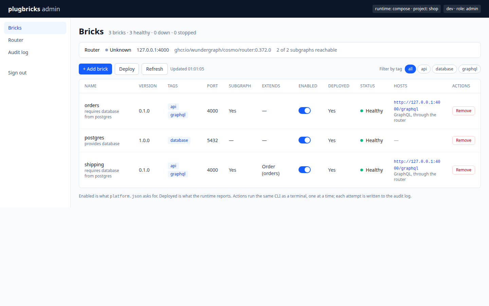
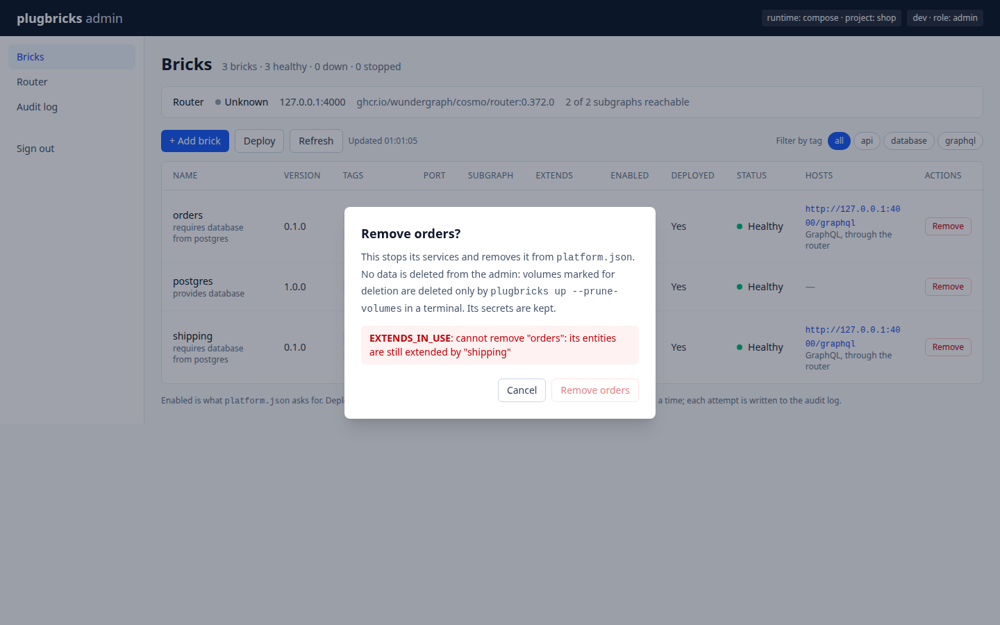
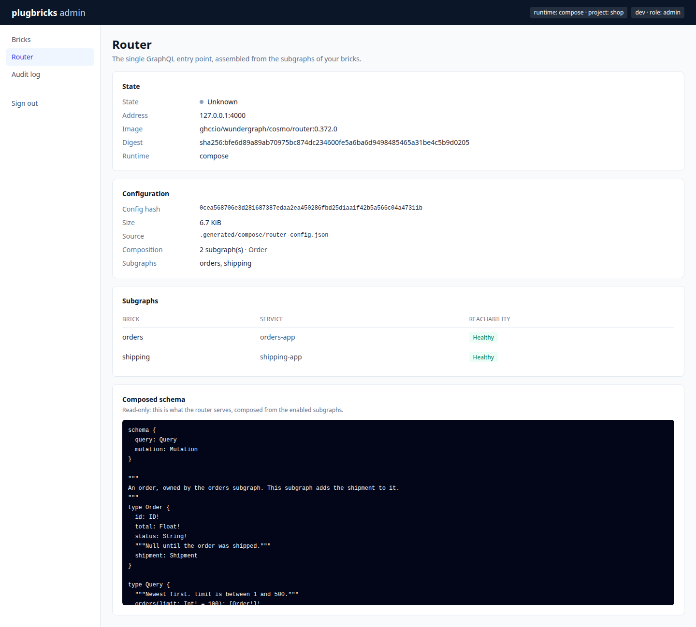
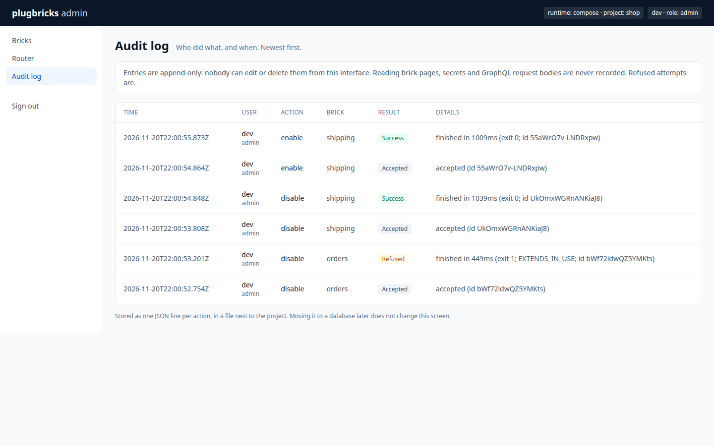
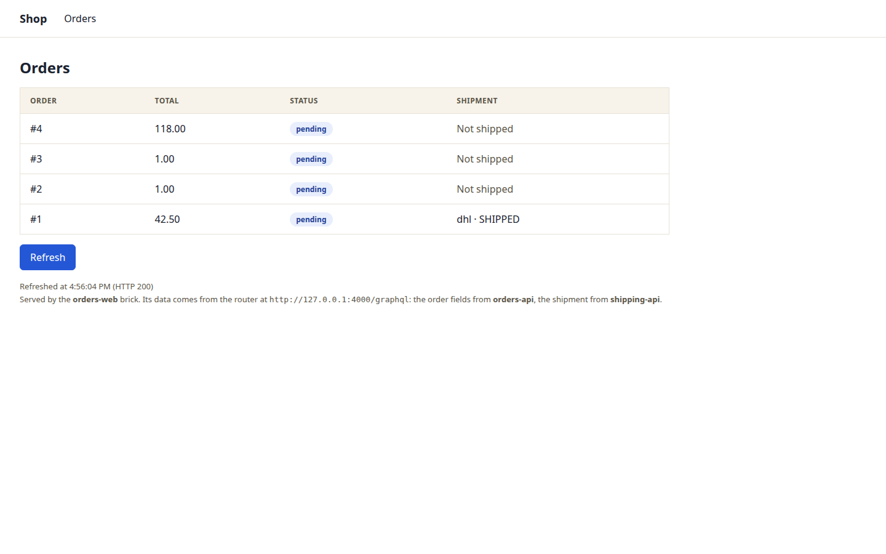
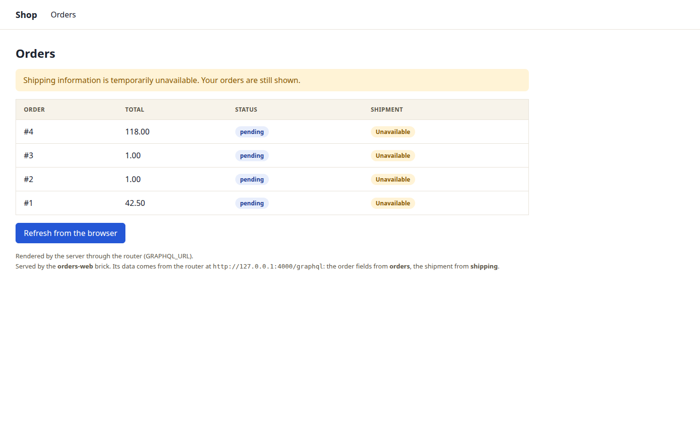

# plugbricks

Add plugins and infrastructure bricks (PostgreSQL, a message queue, …) to a federated GraphQL project, on Docker Compose or Kubernetes, from a single `platform.json`.

Status: **milestone 4 done, milestone 5 done for RabbitMQ and NATS core (Kafka deferred), step 6 done (the admin)** — the `orders` API and the `shipping` API that extends it (GraphQL subgraphs, each with its own database), composition checked when a brick is added, on top of the drivers (`generate`, `up`, `down`), the CLI core (`init`, `add`, `remove`, `status`) and the manifest contract. Both drivers have run end to end: Compose against Docker, and Kubernetes on a throwaway k3d cluster in CI (job "kubernetes (k3d)", first green on 2026-11-17; the router and shipping scenario runs there since 2026-11-18). The Cosmo router is rendered for both runtimes (its configuration, its pinned image, loopback-only on Compose, a ClusterIP Service on Kubernetes). On Docker Compose and on Kubernetes, real requests through it reach the real `orders` and `shipping` APIs and their databases (end-to-end tests). `plugbricks status --runtime` reports what the runtime really runs, read-only, with a versioned JSON report (D10).

## Use

```bash
npm create plugbricks mon-saas      # a new project; its README explains every folder
cd mon-saas
npx plugbricks add path/to/postgres # a brick that provides "database"
npx plugbricks add services/orders  # requires "database"
npx plugbricks add path/to/rabbitmq # a brick that provides "queue" (D11)
npx plugbricks status               # add --json for machine-readable output
npx plugbricks status --runtime compose   # also what the runtime really runs (read-only)
npx plugbricks up                    # Docker Compose
npx plugbricks up --runtime k8s --context my-cluster   # Kubernetes: you always name the cluster
npx plugbricks down                  # stops everything; volumes and secrets are kept
npx plugbricks remove orders
npx plugbricks disable shipping      # installed but no longer deployed; volumes and secrets are kept
npx plugbricks enable shipping       # deploy it again
npx plugbricks up --prune-volumes    # deletes only the volumes listed in pendingDeletion
```

`plugbricks` manages three things in a project:

- `platform.json` — what you want: installed bricks and where each came from, and `router.port` (default 4000, 1024 to 65535): the port the router is published on, on `127.0.0.1` only, with Docker Compose, and the port of its ClusterIP Service on Kubernetes.
- `platform.lock` — what was resolved: versions, an integrity hash per brick, which brick provides each capability, wait settings with their defaults made explicit, the volumes kept after a removal (`retainedVolumes`) and the volumes marked for deletion (`pendingDeletion`). A driver deletes only the volumes in `pendingDeletion`, and only with `up --prune-volumes` (milestone 3); see `docs/decisions.md`. Deterministic: the same `add` twice leaves identical files.
- `.platform/bricks/<name>/` — a copy of each installed brick; `status` reports a copy that was edited.
- `.generated/<runtime>/` — what `generate` (and `up`) writes from the lock and the copies: `compose/compose.yaml`, or `k8s/namespace.yaml` and `k8s/resources.yaml`, and `router-config.json` beside them when an installed brick serves a subgraph. Never edited, never committed (the folder ignores itself).
- `.secrets/` — generated passwords (`secrets.env`, and `k8s-secret.yaml` for Kubernetes). Restricted to your user and checked before every write; never committed. Removing a brick keeps its secrets.

`up` returns once every service runs and passes its healthcheck (Compose `--wait`, Kubernetes `rollout status`). It starts, for each consumer and capability, a wait step (the provider's `ready` command, up to `timeoutSeconds`), then the provider's provision task, then the consumer. A wait that gives up is reported as `WAIT_TIMEOUT`. When at least one brick serves a subgraph, plugbricks also starts the Cosmo router in front of them (`generate` builds its configuration from the subgraphs; it is not a brick, see D9). It is the only thing published on the host: with Compose on `127.0.0.1:<router.port>`, with Kubernetes as a ClusterIP Service (no Ingress, no NodePort). `status` shows its port and its image, pinned by digest. See `docs/decisions.md` (D5, D6).

Every refusal prints `error <CODE>: <message>` with a stable code from `src/messages.ts`. Exit codes: 0 success, 1 refused or inconsistent, 2 usage error.

### `status --runtime`: what really runs

`plugbricks status` shows the declared state: the installed bricks, the composition, the router. `plugbricks status --runtime <compose|k8s>` also asks the runtime what it really runs, and puts the two side by side. It only reads (D10): one `docker compose ps --all --format json` and one `docker inspect` restricted to the restart counts, or one `kubectl get deployments,pods,services --output json`. It never execs into a container, never reads logs, Secrets or environment variables, and never sends a request to a service: the health it reports is the runtime's own. Every call has a 15 s timeout (kubectl also gets `--request-timeout=10s`).

```bash
npx plugbricks status --runtime compose            # a table
npx plugbricks status --runtime compose --json     # the versioned JSON report
npx plugbricks status --runtime k8s --context my-cluster [--kubeconfig file] [--json]
```

There is no runtime field in `platform.json`: name the runtime, as for `up` and `down`. Kubernetes needs the same explicit `--context` (and optional `--kubeconfig`) as `up`, with the same refusals (`K8S_CONTEXT_REQUIRED`, `K8S_CONTEXT_REFUSED`, `K8S_KUBECONFIG_NOT_FOUND`).

For each installed brick and each of its services, and for the router: `enabled` (installed and not disabled in `platform.json`, see `enabled` and `tags` below), `deployed` (the runtime has a container or a Deployment for it), `state`, a short `reason`, the restart count and the container or pod names. A difference between the two is flagged: `mismatch` is `not-deployed` (enabled, nothing running) or `not-declared` (running under the platform's name, not in `platform.json`, listed under `undeclared`). The router also gives its published address (Compose: `127.0.0.1:<port>`; Kubernetes: `<cluster IP>:<port>` of its Service), the digest of the image the runtime reports, and the state of each subgraph service it calls.

| `state`        | Meaning                                                                                                     |
| -------------- | ----------------------------------------------------------------------------------------------------------- |
| `healthy`      | Running, and its health check (Compose healthcheck, Kubernetes readiness probe) passes.                    |
| `starting`     | Not ready yet: health check not passed yet, init containers running, rollout in progress.                  |
| `unhealthy`    | Running but failing: failing health check, restart loop, CrashLoopBackOff, image pull error, unschedulable. |
| `stopped`      | Exited (with its exit code), created but never started, or scaled to 0.                                    |
| `not deployed` | The runtime has nothing for it.                                                                             |
| `unknown`      | Running with no health check to tell (the router on Compose: its image has no shell), or a state plugbricks does not know. Never counted as a problem. |

Exit codes of `status --runtime`: **0** every enabled service and the router are `healthy` or `unknown`; **1** the declared state is inconsistent (the same problems as `status`) or the cluster is refused; **2** usage error; **3** an enabled service or the router is `starting`, `unhealthy`, `stopped` or `not deployed`; **4** the runtime cannot be read (`RUNTIME_UNAVAILABLE`: not installed, not answering, or slower than the timeout). Something running but not declared is reported and does not change the exit code.

`--json` prints one document, `"version": 1`, described by [`packages/plugbricks/schemas/status-runtime.schema.json`](packages/plugbricks/schemas/status-runtime.schema.json). Key names are stable within a version; no field holds a time, so two reads of the same runtime state give the same bytes. Shortened example (Compose, the shipping service stopped):

```json
{
  "version": 1,
  "platform": "demo",
  "runtime": "compose",
  "context": null,
  "state": "degraded",
  "bricks": [
    {
      "name": "shipping",
      "enabled": true,
      "tags": ["api", "graphql"],
      "services": [
        {
          "name": "shipping-app",
          "service": "app",
          "enabled": true,
          "deployed": true,
          "state": "stopped",
          "reason": "exited with code 0",
          "restarts": 0,
          "instances": ["demo-shipping-app-1"],
          "subgraph": true,
          "mismatch": null
        }
      ]
    }
  ],
  "router": {
    "name": "router",
    "enabled": true,
    "deployed": true,
    "state": "unknown",
    "reason": "running; no health check",
    "restarts": 0,
    "instances": ["demo-router-1"],
    "mismatch": null,
    "address": "127.0.0.1:4000",
    "image": "ghcr.io/wundergraph/cosmo/router:0.372.0@sha256:bfe6d89a…0205",
    "digest": "sha256:bfe6d89a…0205",
    "subgraphs": [
      { "brick": "orders", "name": "orders-app", "state": "healthy" },
      { "brick": "shipping", "name": "shipping-app", "state": "stopped" }
    ]
  },
  "undeclared": [],
  "problems": []
}
```

This report feeds the **admin** (D15): `plugbricks admin --dev` serves the UI on
`http://127.0.0.1:4100` (Bricks, Router, Audit). Without `--dev`, pass `--issuer` and `--client-id`
and set `PLUGBRICKS_OIDC_CLIENT_SECRET` only for a confidential client (a public client uses PKCE
alone); the account needs `plugbricks-viewer` (read) or `plugbricks-admin` (read and act). A real
Keycloak walkthrough is in [`docs/keycloak.md`](docs/keycloak.md). From the Bricks page an administrator can add a brick (a path
relative to the platform), enable or disable it, remove it, or deploy (`up`); each action runs the
CLI as a child process, one at a time, and is written twice to `.admin/audit.log` (accepted, then its
outcome). There is no `--prune-volumes` in the admin: deleting data stays a terminal decision. A
viewer sees the same pages and cannot change anything. The Router page shows the configuration hash,
size, source, composition and composed schema. The published package carries the built UI
(`prepack` copies it to `dist/admin/ui`), and the `dist` test checks it.

The screenshots below were taken on a real platform (`postgres`, `orders`, `shipping`, `orders-web` and
the router on Docker Compose, admin in `--dev`). On Compose the router has no healthcheck (its image has no shell,
D9), so its state is shown as `Unknown` while it runs.

**Bricks**: what `platform.json` asks for next to what the runtime reports; a subgraph brick is reached
through the router, a web brick's page on its own loopback port.



**Removing a brick**: the dialog shows the CLI's refusal before anything runs, here `orders`, whose
`Order` entity `shipping` extends.



**Router**: the configuration, the subgraphs it calls and the composed schema, read-only.



**Audit log**: two lines per action, accepted then its outcome, refusals included.



### `enabled` and `tags`

A brick can be **disabled without being removed**: `plugbricks disable <name>` writes `enabled: false` in `platform.json`; its services stop (the next `up` removes them), while its volumes and secrets stay. `enable` brings it back, and the federated schema is recomposed either way (D14). `status` marks it `disabled`, and `status --runtime` reports it `stopped` with `enabled: false`, without making the platform degraded.

Commands that change the platform (`add`, `remove`, `enable`, `disable`, `generate`, `up`, `down`) run **one at a time**: each holds `.platform/lock` while it runs, and another one meanwhile is refused with `PLATFORM_BUSY`, whether it comes from a terminal or from the admin. A lock left by a process that died is taken over (D16).

A brick may also declare `tags` (`api`, `graphql`, `database`, `queue`, …) in its `plugin.json`; they are kept in `platform.lock` and shown in the JSON reports, for filtering in the admin.

### `web`: a brick that serves pages

A brick may declare the service that serves its pages: `"web": { "service": "app", "path": "/orders" }`.
`add` gives it a `webPort` in `platform.json`, the first port from 8080 that neither the router nor
another web brick uses (change it there if you like; a port already taken is refused with
`WEB_PORT_CONFLICT`). On Docker Compose the service is published on `127.0.0.1:<webPort>` only; on
Kubernetes it stays a ClusterIP Service, reached with `kubectl port-forward` on the same local port. When
the platform has a router, the service is given `GRAPHQL_URL` (the router inside the platform, for its
server) and `PUBLIC_GRAPHQL_URL` (`http://127.0.0.1:<router.port>/graphql`, for code that runs in the
browser), and the router accepts browser calls from `http://127.0.0.1:<webPort>` and
`http://localhost:<webPort>` only: any other origin gets 403 and its request does not run (D17). With
no web brick, the router accepts only its own origin.

`examples/orders-web` (source `apis/orders-web`) is the shop's orders page: its server reads the orders
and their shipment through the router, and when shipping does not answer it still lists the orders with
the shipment marked unavailable.



With the shipping container stopped, the same page:



### `keycloak`: the platform's own identity provider

`examples/keycloak` is a web brick that requires `database`: Keycloak with the realm `plugbricks` (roles
`plugbricks-admin` and `plugbricks-viewer`, the admin's public client) and **no user**. Build its image once
(`docker build -t plugbricks-example/keycloak:0.1.0 apis/keycloak`), then:

```bash
npx plugbricks add path/to/postgres
npx plugbricks add path/to/keycloak    # its console: http://127.0.0.1:<webPort>/admin/
npx plugbricks up                      # returns once the realm answers (about 2 minutes the first time)
```

Sign into the console as `admin` with the password `PB_KEYCLOAK__ADMIN_PASSWORD` from
`.secrets/secrets.env`, create the users and give them `plugbricks-admin` or `plugbricks-viewer`, then:

```bash
npx plugbricks admin --issuer http://127.0.0.1:<webPort>/realms/plugbricks --client-id plugbricks-admin
```

The brick uses `${web.origin}`, the address the browser uses (`http://127.0.0.1:<webPort>`), a template
allowed only in the env of a web brick's own service. The realm is imported on the first start only, and
the admin must run on port 4100, the redirect URI of the realm's client (D18).

### `queue`: one message broker for every service that needs it

`examples/rabbitmq` is a brick that provides the `queue` capability. Install it once, then any number of bricks can require it:

```bash
npx plugbricks add path/to/rabbitmq   # provides "queue"
npx plugbricks add services/orders    # requires "queue": receives AMQP_URL
```

Each consumer gets its **own vhost, user and password**: `AMQP_URL=amqp://<brick>:<its secret>@rabbitmq-broker:5672/<brick>` and `QUEUE_NAME=<its brick name>` (D11, D12). A service declares and uses its own queue on the shared broker; the broker's administrator password is only used by the provision task, never injected into a consumer. The broker is never published, its data volume is kept by `down` and by `remove`, and its management port 15672 is an extra port of its Service (ClusterIP, never on the host).

The example `examples/queue-consumer` shows the whole path: it declares its queue, publishes one message, consumes it, and its `/health` answers 200 only once that round-trip succeeded. The end-to-end tests use it, on Docker Compose and on k3d.

`examples/nats` is a **second `queue` provider** (D13): core NATS only, with `NATS_URL` and `SUBJECT` per consumer, no accounts and no JetStream. Like RabbitMQ, it is an alternative — a platform has one queue provider at a time.

## Layout

An npm workspaces monorepo. The root `package.json` runs `build`, `test` and `typecheck` in every package.

- `packages/plugbricks/` — the core library and the `plugbricks` CLI.
  - `schemas/plugin-manifest.schema.json` — the plugin contract (runtime-independent).
  - `schemas/platform.schema.json`, `schemas/platform-lock.schema.json` — the two project files, as strict as the manifest.
  - `schemas/status-runtime.schema.json` — the report of `status --runtime --json`, version 1 (D10).
  - `examples/postgres/` — a base brick that provides the `database` capability; `provision/create-database.sh` creates one role and one database per consumer (idempotent).
  - `examples/orders/` — an API that requires `database` (waits until it is healthy) and exposes a federation v2 subgraph.
  - `examples/rabbitmq/` — a base brick that provides the `queue` capability: one RabbitMQ broker shared by every consumer, each getting its own vhost, user and `QUEUE_NAME` (D11, D12); its provision script creates them through the management API.
  - `examples/nats/` — a second `queue` provider: a NATS server (core publish/subscribe), `NATS_URL` and `SUBJECT` per consumer, no accounts or JetStream (D13).
  - `examples/queue-consumer/` — an API that requires `queue`: it declares its queue, publishes one message, consumes it, and exposes the round-trip on `/health` (`apis/queue-consumer`).
  - `src/manifest.ts` — `validateManifest()`: schema validation plus cross-field rules (unique service names, pinned images, referenced services exist). Every issue has a stable `code`, a JSON Pointer `path`, a `message` and its `params`.
  - `src/messages.ts` — the error code catalog. Tools match on `code`, never on the message text.
  - `src/platform.ts` — `initPlatform`, `addBrick`, `removeBrick`, `platformStatus`: the CLI logic, with no console output.
  - `src/cli.ts`, `src/bin.ts` — argument parsing, output and exit codes; `bin.ts` is the `plugbricks` executable.
  - `src/schemas.ts`, `src/issues.ts` — schema loading (each `$id` checked at startup) and the Ajv-to-code mapping shared by the four schemas.
  - `src/templates.ts` — `${provider.host}`, `${provider.port}`, `${consumer.name}`, `${secrets.<name>}`: which field accepts which.
  - `src/plan.ts` — the runtime-independent plan built from the lock and the installed copies: services, wait and provision steps, volumes, secrets; runtime name checks.
  - `src/drivers/compose.ts`, `src/drivers/k8s.ts` — pure functions plan → files. `src/yaml.ts` writes them deterministically.
  - `src/runtime.ts` — `generate`, `up`, `down`, `status --runtime`: secrets, files, then `docker compose` or `kubectl`, through an injectable executor.
  - `src/live.ts` — pure parsing and the report of `status --runtime`: state, reason, restarts and instances per brick, service and router, `enabled` vs `deployed` (D10).
  - `src/secrets.ts` — restricting and checking `.secrets/`, generating and reading secrets.
  - `src/image.ts` — image reference parsing and the pinning rule: a sha256 digest, or a tag starting with at least `MAJOR.MINOR` (`16.4-alpine`, `v1.2.3`). `latest`, `16`, `alpine` are rejected.
  - `test/fixtures/invalid/` — one invalid manifest per file, each with exactly one fault; `expected.json` gives the code and path it must produce.
  - `test/fixtures/cli/` — one folder per CLI scenario: `scenario.json` (steps, expected exit code, error codes, output, and the exact `docker`/`kubectl` commands, run by a fake executor), optional `bricks/` and golden `expected/` files (including `.generated/` output). Regenerate the golden files with `PLUGBRICKS_UPDATE_GOLDEN=1 npm test -w plugbricks`, then review the diff.
  - `test/` — Vitest suite, including `dist.test.ts`, which packs the package with `npm pack` and runs the built CLI, and `e2e-compose.test.ts`, which runs `up`/`down` against a real Docker engine (skipped, with the reason, where no Linux engine answers).
- `apis/orders/` — the source of the `orders` example API (Node 22, GraphQL Yoga, `@apollo/subgraph`, `pg`): a federation v2 subgraph with its own migrations and `/health`. Built as the image `plugbricks-example/orders:0.1.0` (`docker build -t plugbricks-example/orders:0.1.0 apis/orders`), which `examples/orders/plugin.json` runs. A standalone package with its own lockfile: the brick folder holds only the manifest and the SDL, so `add` never copies `node_modules`. Its tests check that its SDL is the brick's. The image is built locally and is not published to a registry yet: build it before `up`, and load it into a Kubernetes cluster (for example `k3d image import`) before `up --runtime k8s`.
- `apis/shipping/` — the source of the `shipping` example API, same shape as `apis/orders` (its own lockfile, migrations, `/health`, image `plugbricks-example/shipping:0.1.0`, built with `docker build -t plugbricks-example/shipping:0.1.0 apis/shipping`). Its subgraph extends the `Order` entity of the orders API with a `shipment` field (`examples/shipping/plugin.json` declares `extends: [{ plugin: "orders", entities: ["Order"] }]`) and keeps its data in its own database, which the orders API cannot reach. Its tests check that its SDL is the brick's, and a test composes all the example bricks together.
- `apis/queue-consumer/` — the source of the queue consumer example (Node 22, `amqplib`, `/health`), same shape as `apis/orders`: a standalone package with its own lockfile, image `plugbricks-example/queue-consumer:0.1.0`, built with `docker build -t plugbricks-example/queue-consumer:0.1.0 apis/queue-consumer`. It connects with its own `AMQP_URL`, declares `QUEUE_NAME`, publishes one message and consumes it; `/health` answers 200 only after that round-trip. Its tests check the health state machine.
- `packages/create-plugbricks/` — `npm create plugbricks <name>`: copies `template/`, writes `package.json`, and calls `initPlatform` from `plugbricks`.
- `docs/decisions.md` — design decisions taken ahead of their implementation, with their evidence.
- `docs/architecture.md` — how the pieces fit together, from the manifest to the running containers, with what is built and what is planned.

Tests write only inside `.test-work/` folders of each package (gitignored).

## Develop

```bash
npm ci
npm run hooks:install   # once per clone: turns on the git hooks of .githooks/
npm test
npm run typecheck
```

Code quality, all from the repository root:

| Command                | What it does                                                                                           |
| ---------------------- | ------------------------------------------------------------------------------------------------------ |
| `npm run format`       | Prettier rewrites the code, JSON and YAML                                                              |
| `npm run format:check` | Prettier only checks (what CI runs)                                                                    |
| `npm run lint`         | ESLint (flat config, typescript-eslint)                                                                |
| `npm run typecheck`    | `tsc --noEmit` in each package                                                                         |
| `npm test`             | every test, including the Docker end-to-end ones                                                       |
| `npm run test:unit`    | every test except the Docker and Kubernetes end-to-end ones (what the pre-push hook runs)              |
| `npm run coverage`     | unit tests with a V8 coverage report, no threshold                                                     |
| `npm run quality`      | `format:check`, `lint`, `typecheck`, `test`, in this order: the CI `quality` job runs exactly this     |

Test inputs, golden files, the example bricks and the project template are never formatted or linted:
they are hashed or compared byte for byte. Hooks, CI jobs and the reasons are in `docs/decisions.md` (D7).

Supported on Linux, macOS and Windows with Node 22.12 or newer (`engines` says so; the exact version CI and the dev container use is in `.node-version`). The router configuration loads `@wundergraph/cosmo-shared`, an ES module, with `require()`, which Node supports without a flag from 22.12; Node 20.19 also built the configuration in a manual check, but CI does not test it, so it is not claimed.
CI (`.github/workflows/ci.yml`) runs the three commands above on all three systems; see
`docs/decisions.md` (D4) for what differs between them and how it is handled. `tools.json` pins
k3d and kubectl per OS and architecture, for a Kubernetes end-to-end test.

Run a script in one package only with `npm test -w plugbricks`.

### Dev container

Open the repo in a dev container ("Dev Containers: Reopen in Container" in VS Code); it runs `npm ci` on creation. Then:

```bash
npm test
```

The container has Node 22 and access to the host's Docker, so `npm test` runs the Compose end-to-end test there too.

Dependencies are pinned to exact versions (`.npmrc` sets `save-exact`), and `package-lock.json` is committed: always install with `npm ci`.

## Roadmap

1. **Manifest schema + examples** — done
   - `requires` as an object per capability, with an optional `wait` (`healthy` by default, or `started`).
   - Volume `retention` (`retain` by default, or `delete`) for what happens to data when a plugin is removed.
   - Stable error codes and a message catalog; invalid examples kept as files.
   - Images pinned to an exact version or a digest, for services and provision tasks.
   - Schema `$id` set to the raw GitHub URL of the schema file; a working, idempotent PostgreSQL provision script.
2. **CLI core** — done: `init`, `add`, `remove`, `status`, `platform.json` / `platform.lock`, `npm create plugbricks`
   - Manifest: `requires.<cap>.timeoutSeconds`, `provides.<cap>.ready`, healthcheck `timeoutSeconds` and `startPeriodSeconds` (from experiment D).
3. **Drivers** — done: `generate`, `up`, `down`, `up --prune-volumes` on Docker Compose and Kubernetes, rendered by plugbricks itself (D5, Score dropped); generated secrets (D6); templates checked at `add`.
   - Done: the Kubernetes end-to-end test (`packages/plugbricks/test/e2e-k8s.test.ts`) and the CI job "kubernetes (k3d)": `up` with postgres and orders, a GraphQL call, `down`, `remove` + `up --prune-volumes`, `WAIT_TIMEOUT`, on a throwaway k3d cluster named `pbtest-*` (it is skipped for any other context). Its `WAIT_TIMEOUT` scenario used to wait about five minutes for the rollout deadline; `up` now reads the wait init containers every 15 s and reports it at once (D5).
   - Later pass: kill the database pod, then `up` again, and check that the platform recovers and the data is kept.
4. **Federation**: real APIs, the Cosmo router, composition checked at `add`, a second API with `extends`
   - Done: the `orders` API (`apis/orders`), tested alone and on a platform.
   - Done: composition of the subgraphs checked at `add`, `remove` and `status` (`@wundergraph/composition`, D8): `COMPOSITION_FAILED`, `SUBGRAPH_SCHEMA_INVALID`, `EXTENDS_*`; a `federation` section in `platform.lock`.
   - Done (4b-2): the `shipping` API (`apis/shipping`) extends `Order` of `orders` (`examples/shipping`), tested alone, composed with `orders` in the tests, and end to end on Docker Compose (own database, no access to the orders database, `_entities` answered, data kept across `down` and `up`).
   - Done (4b-3): the router is rendered for Docker Compose and Kubernetes: `router-config.json` built in process from the composition, the router image pinned by digest (`tools.json`), `router.port` in `platform.json`, golden-file tests (D9).
   - Done (4b-4): real requests through the router on Docker Compose (`e2e-compose`): an order created through the router, then shipped, then read back in one request that reaches both `orders` and `shipping`; a validation error does not crash it; the playground is off; `remove shipping` then `up` recreates the router without the `shipment` field, `add shipping` brings it back; `remove orders` stays refused while shipping extends it; after `down` no router and no published port; with no subgraph, no router. The known limits observed there are in D8.
   - Done (4b-5): the cross-check of our router configuration against `wgc router compose` (wgc 0.133.12, pinned in `tools/wgc-crosscheck`): equal except an empty `featureFlagConfigs` (D9). The end-to-end test of the router and shipping on k3d, with requests through the router, a rollout when the composition changes and `down`, runs green in the `kubernetes (k3d)` job since 2026-11-18 (PR #14, and on `main`).
   - Done (5a): `status --runtime compose|k8s [--json]`: what the runtime really runs next to what is declared, read-only (D10), with a versioned JSON report (`schemas/status-runtime.schema.json`) and its own exit codes (3 degraded, 4 `RUNTIME_UNAVAILABLE`). Tested with recorded Compose output and hand-written Kubernetes Lists, end to end on Docker Compose, and on k3d in CI.
   - Before the first publication: check the licences of what we ship (`docs/pre-publication-checklist.md`) and the package names (the npm names are not checked and the packages are `private` today); decide the first version number (everything is 0.0.1 and `UNLICENSED`); verify the signature of the tool checksums (`tools.json` checks a sha256 taken from the same release as the binary, not a signature); and settle the development-dependency vulnerabilities of the vitest 2 chain (D7: a major upgrade).
5. **Message queue**
   - Done (5b): `examples/rabbitmq` provides `queue`: one broker, any number of consumers, each with its own vhost, user and `QUEUE_NAME`; golden scenario, end to end on Docker Compose, and the same scenario in the k3d job (D11).
   - Done (5b-bis): `services[].extraPorts` and one RabbitMQ account per consumer, through the management API (D12).
   - Done (5b-ter): a real consumer (`examples/queue-consumer`, source `apis/queue-consumer`) publishes and consumes a message through the broker, on Docker Compose and k3d.
   - Done (5c): `examples/nats` provides `queue` with core NATS (`NATS_URL`, `SUBJECT`), tested with a pinned `nats-box` client on Docker Compose and k3d (D13). Kafka stays deferred.
   - Deferred: Kafka, and NATS accounts/JetStream, which need a configuration file or command line the manifest cannot express today.
6. **Admin** — done
   - Done (5d): `enabled` in `platform.json` (`enable` / `disable`: installed but not deployed) and `tags` in `plugin.json` (D14).
   - Done (6b): one changing command at a time, `.platform/lock` and `PLATFORM_BUSY` (D16).
   - Done (6, 6c, 6d): `plugbricks admin` on `127.0.0.1:4100`, the Bricks, Router and Audit pages, OIDC sign-in with the roles `plugbricks-viewer` and `plugbricks-admin`, actions (`add`, `enable`, `disable`, `remove`, `up`) run through the CLI and written to `.admin/audit.log`, the UI shipped in the package (D15).
   - Done (7a): the router accepts browser calls only from the origins it lists; it used to accept every origin, and a cross-site mutation ran (D17).
   - Done (7b): web bricks: `web` in the manifest, `webPort` in `platform.json`, published on 127.0.0.1 only, `GRAPHQL_URL` and `PUBLIC_GRAPHQL_URL`, the example `orders-web`, tested end to end on Docker Compose and on k3d (D17).
   - Done (7c): a Keycloak brick (`examples/keycloak`, image from `apis/keycloak`): the platform's own identity provider for the admin, tested end to end on Docker Compose with a real sign-in (D18).
   - Done (8a): optional requirements, `"optional": true` in a brick's `requires`: without a provider the brick runs as it is, with one it is wired, even when the provider is added later (D19).
   - Done (8b): `examples/keycloak` provides `oidc`: each brick that requires it gets its own confidential client and `OIDC_TOKEN_URL`, `OIDC_CLIENT_ID`, `OIDC_CLIENT_SECRET`; `orders-web` requires it optionally (D19).
