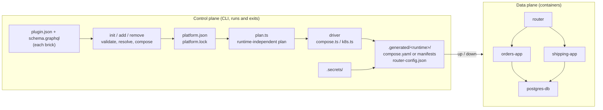
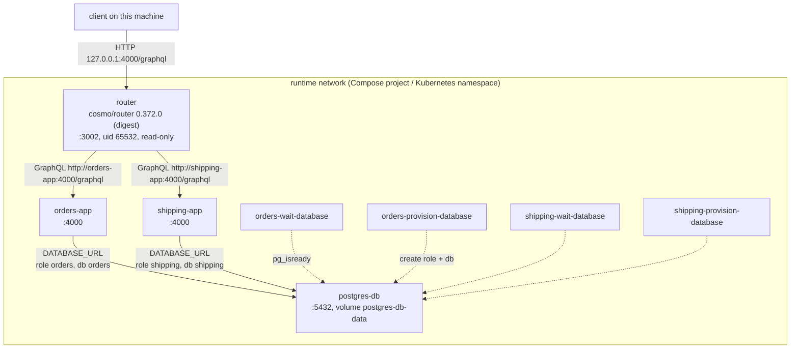
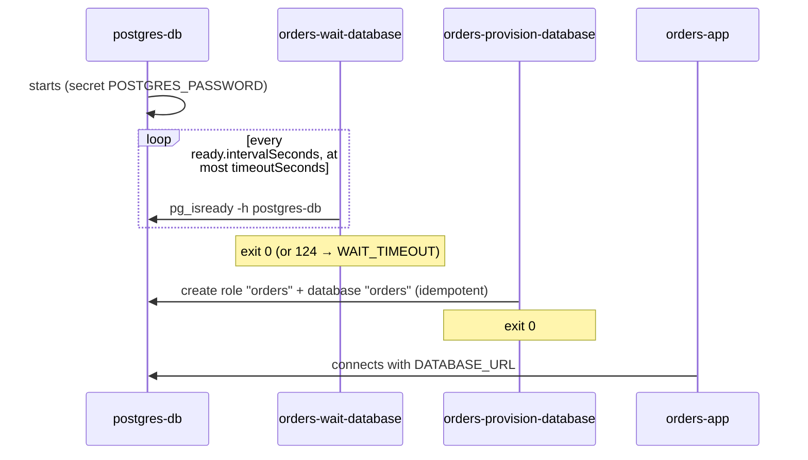
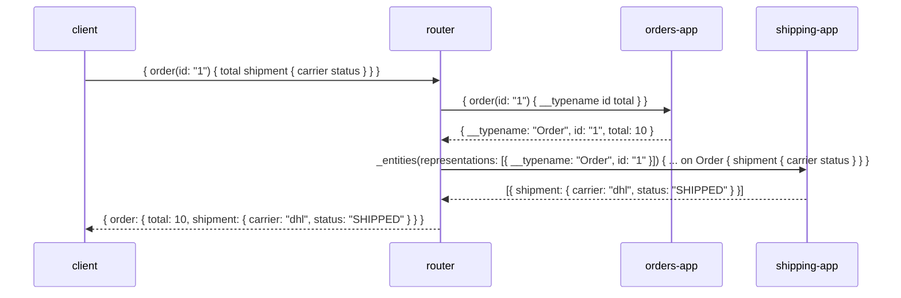
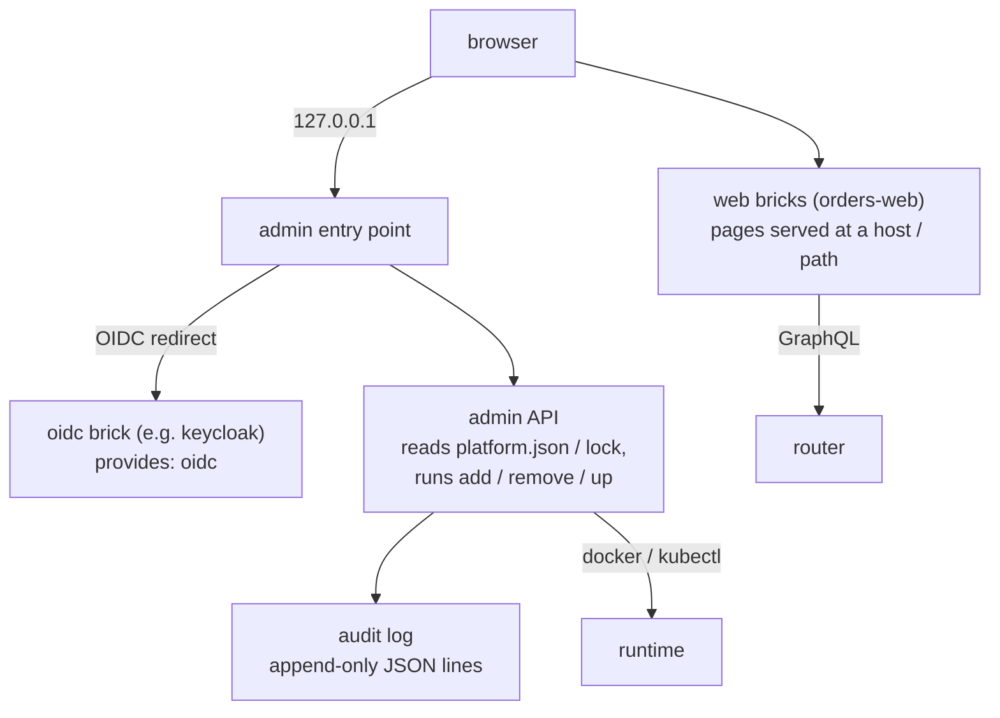

# Architecture

How plugbricks works, from the files a user writes to the containers that answer a GraphQL request.
This document grows with the project: each section says whether it describes what is **built** or
what is **planned**. The reasons behind each choice are in `docs/decisions.md` (D1 to D10); this
document links to them instead of repeating them.

## 1. Vocabulary

| Word | Meaning |
|---|---|
| **Brick** | A directory with a `plugin.json` (the manifest): one or more services, what it provides, what it requires, optionally a GraphQL subgraph. Example: `postgres`, `orders`, `shipping`. |
| **Service** | One container of a brick. Its runtime name is `<brick>-<service>` (`postgres-db`, `orders-app`), which is also its DNS name on the runtime network. |
| **Capability** | A named thing a brick provides and others require, for example `database`. One provider per capability on a platform. |
| **Subgraph** | The GraphQL schema a brick serves (`subgraph` in the manifest), written in Federation v2. |
| **Router** | The Cosmo router, the single GraphQL entry point. Not a brick: plugbricks adds it when at least one brick serves a subgraph (D9). |
| **Platform** | A project directory with `platform.json` (what the user asked for) and `platform.lock` (what was resolved). |
| **Driver** | Turns the platform into runtime files: Docker Compose or Kubernetes (D5). |

## 2. Two planes

plugbricks is split like most platforms:

- the **control plane** decides *what should run*. Today it is the `plugbricks` CLI only; it reads
  manifests, checks them, writes `platform.json` / `platform.lock`, renders runtime files and calls
  `docker compose` or `kubectl`. It never stays running.
- the **data plane** is *what runs*: the services of the bricks, their wait and provision tasks, and
  the router. It does not know plugbricks exists; it only sees the files the driver rendered.



## 3. Control plane: from a manifest to running containers (built)

1. **`add <dir>`** validates the manifest against `schemas/plugin-manifest.schema.json`, checks the
   templates (D6), the image pinning rule, the runtime names, then resolves capabilities: a brick that
   requires `database` is refused while no installed brick provides it (the provider is never added
   automatically). If the platform would serve subgraphs, they are **composed before anything is
   written** (D8); a composition error refuses the add. The brick is copied, and its integrity hash
   goes into `platform.lock`.
2. **`remove <name>`** runs the same checks for the platform without the brick. It is refused while
   another brick requires what it provides, or extends one of its entities (`EXTENDS_IN_USE`). Its
   volumes are kept by default (`retainedVolumes`, D3); its secrets are always kept (D6).
3. **`generate`** builds a plan from the lock and the installed copies (integrity checked again), then
   the driver renders it. Drivers are pure functions plan → files, tested with golden files.
4. **`up` / `down`** render, then call the runtime. `up --prune-volumes` deletes only the volumes the
   lock lists in `pendingDeletion`.
5. **`status`** compares what was asked, what was resolved and the federation hash
   (`FEDERATION_CHANGED`). `status --runtime compose|k8s` adds what the runtime really runs,
   read-only (D10): per brick, service and router, `enabled` vs `deployed`, state, reason, restart
   count and instances, as a table or as a versioned JSON report (`schemas/status-runtime.schema.json`).

## 4. Data plane: the example shop (built)

With `postgres`, `orders` and `shipping` installed on Docker Compose, `generate` renders these
services (golden file `test/fixtures/cli/generate-compose`, plus shipping):



Who talks to whom:

| From | To | Protocol | Credential | Why |
|---|---|---|---|---|
| client | router | HTTP, `127.0.0.1:<router.port>` only | none yet | the only published port (D9) |
| router | `orders-app`, `shipping-app` | GraphQL over HTTP, internal names | none | federated query plan |
| `orders-app` | `postgres-db` | PostgreSQL | its own role and password, `DATABASE_URL` | its data |
| `shipping-app` | `postgres-db` | PostgreSQL | its own role and password | its data; refused on the `orders` database |
| `<consumer>-wait-database` | `postgres-db` | `pg_isready` | none | waits until the database answers |
| `<consumer>-provision-database` | `postgres-db` | `psql` | superuser password | creates the consumer's role and database, idempotent |

Rules that hold for every platform:

- **No brick talks to another brick's storage.** Each consumer gets its own role, database and
  password from the provider; shipping knows orders only through the graph.
- **Only the router is published**, and only on the loopback address (Compose) or as a ClusterIP
  Service (Kubernetes). No Ingress, NodePort or LoadBalancer.
- **Secrets never appear on a command line or in `.generated/`.** They live in `.secrets/`, mode 0600,
  and reach containers as environment variables (D6).

## 5. How a capability is wired: `provides` / `requires` (built)

The provider describes, once, how to make itself usable by any consumer. In `examples/postgres`:

- `ready`: a command run from outside that exits 0 when the database accepts connections;
- `provision`: a one-shot task (image + script) that creates the consumer's role and database;
- `inject`: the variables added to each consumer, here
  `DATABASE_URL=postgres://${consumer.name}:${secrets.consumer_password}@${provider.host}:${provider.port}/${consumer.name}`.

The consumer only says `"requires": { "database": { "wait": "healthy", "timeoutSeconds": 120 } }`.
The start order is the same on both runtimes (D5):



Compose chains the tasks with `service_completed_successfully`; Kubernetes runs them as init
containers `wait-database` and `provision-database` in each consumer pod.

Secret scope (D6): a secret the provider's own services use belongs to the provider
(`PB_POSTGRES__SUPERUSER_PASSWORD`); any other secret in `provision` or `inject` is generated per
consumer (`PB_POSTGRES__ORDERS__CONSUMER_PASSWORD`).

The same wiring carries `queue` (D11, D12). `examples/rabbitmq` provides one broker; `ready` is a TCP
check, and the provision task creates the consumer's vhost, user and permissions through the management
API (an `extraPorts` port of the Service). Each consumer gets `AMQP_URL` with its own credentials and
`QUEUE_NAME=<its brick name>`, then declares its own queue.

## 6. GraphQL Federation v2 (built)

Each API brick serves a **subgraph**. Both examples declare Federation 2.5:

```graphql
extend schema @link(url: "https://specs.apollo.dev/federation/v2.5", import: ["@key"])
```

**Entity ownership.** `orders` owns the entity `Order` (`id`, `total`, `status`) with
`@key(fields: "id")`. `shipping` declares the same entity with the same key and adds one field,
`shipment`. Its manifest says so explicitly: `"extends": [{ "plugin": "orders", "entities": ["Order"] }]`.
That field is what lets plugbricks refuse `shipping` without `orders` (`EXTENDS_OWNER_MISSING`) and
refuse `remove orders` while shipping is installed (`EXTENDS_IN_USE`); composition alone cannot see
that intent (D8).

**At add time** (`src/federation.ts`, the only file importing the composer):


**At request time**, a query that spans both subgraphs:



The two sub-requests show the Federation v2 mechanism, not a capture: the exact text the router
sends was not recorded. What was checked end to end on Docker Compose (D8, D9) is the client's request
and answer, and that shipping answers `_entities` for an `Order` it never stored: it only needs the key.

**Known limits** (D8, kept on purpose and asserted by tests): `shipOrder` accepts an order id that does
not exist, because shipping cannot see the orders database; and a brick that redefines an entity
without listing it in `extends` is not detected.

## 7. Security model of the data plane (built)

| Concern | Rule | Where |
|---|---|---|
| Exposure | only the router, loopback / ClusterIP | D9 |
| Images | pinned to `MAJOR.MINOR` at least, or a digest; the router by digest | `src/image.ts`, `tools.json` |
| Router | non-root (65532), read-only filesystem, no capability, playground off, telemetry off | D9 |
| Data | one role and database per consumer; volumes kept unless pruned explicitly | D3, `examples/postgres` |
| Secrets | random, 0600, never on a command line, never in `.generated/`, never deleted | D6 |
| Kubernetes | never the current context; `--context` required | D5 |

## 8. Planned: what the admin mockup adds (not built)

The admin mockup (Bricks, Router, Audit log, Sign in, a shop page) needs pieces that do not exist yet.
This is a first proposal, to be settled one decision at a time in `docs/decisions.md`.



Open questions, in the order they block the mockup:

1. **`enabled` separate from installed.** The mockup distinguishes *Enabled* (asked in `platform.json`)
   from *Deployed* (reported by the runtime). Today a brick in `platform.json` is always meant to run.
2. **Runtime status per brick** (healthy, starting, down, stopped, with a reason): **done** in
   `status --runtime` (D10); the admin page would consume its JSON report.
3. **Tags** in the manifest, for filtering.
4. **Web bricks**: a service that serves pages. The router is GraphQL only, so pages need their own
   published entry (and therefore a change to the loopback-only rule of D9, or a second published port).
5. **Who runs the admin.** A long-running process is a new kind of component: plugbricks has only a
   CLI today. It must hold the runtime credentials, so its access rules (roles `plugbricks-admin`,
   `plugbricks-viewer`) and its audit log come before any button that changes something.
6. **Identity**: an `oidc` capability provided by a brick, required by the admin and by API bricks
   that check tokens; the router could validate JWTs before forwarding.
7. **Messaging** (roadmap milestone 5, NATS): a `queue` capability with the same provides / requires
   wiring as `database`.
