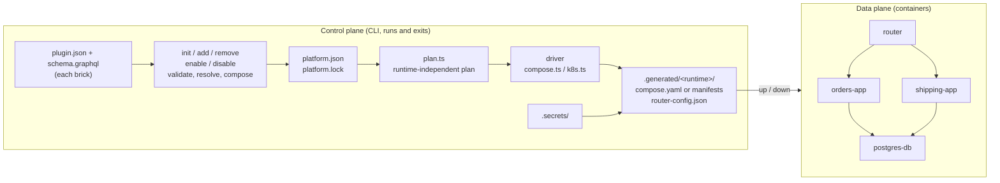
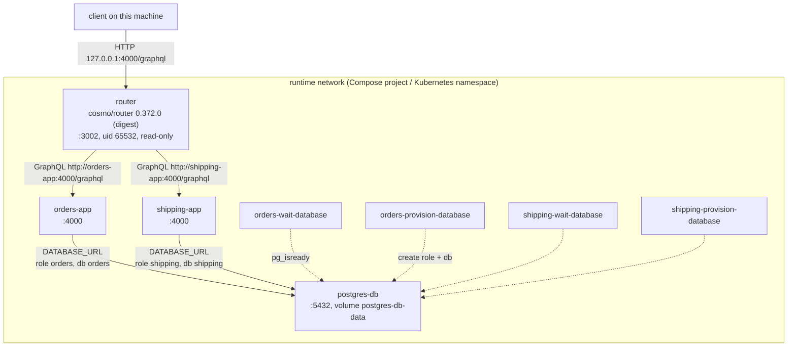
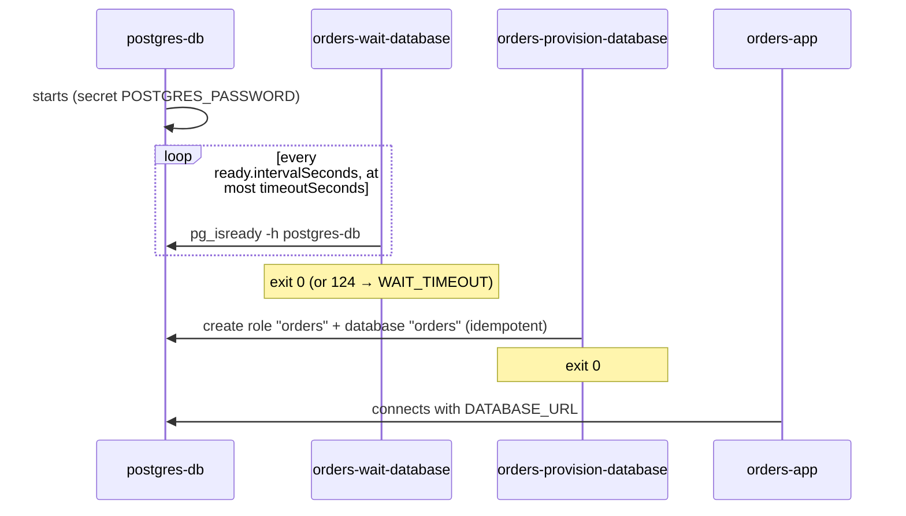
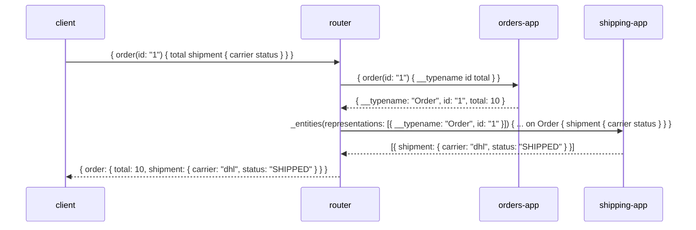
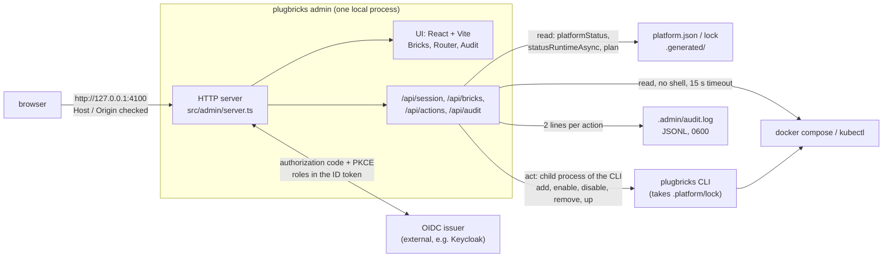

# Architecture

How plugbricks works, from the files a user writes to the containers that answer a GraphQL request.
This document grows with the project: each section says whether it describes what is **built** or
what is **planned**. The reasons behind each choice are in `docs/decisions.md` (D1 to D10); this
document links to them instead of repeating them.

## 1. Vocabulary

| Word | Meaning |
|---|---|
| **Brick** | A directory with a `plugin.json` (the manifest): one or more services, what it provides, what it requires, optionally a GraphQL subgraph. Example: `postgres`, `orders`, `shipping`. |
| **Service** | One container of a brick. Its runtime name is `<brick>-<service>` (`postgres-db`, `orders-app`), which is also its DNS name on the runtime network. |
| **Capability** | A named thing a brick provides and others require, for example `database`. One provider per capability on a platform. |
| **Subgraph** | The GraphQL schema a brick serves (`subgraph` in the manifest), written in Federation v2. |
| **Router** | The Cosmo router, the single GraphQL entry point. Not a brick: plugbricks adds it when at least one brick serves a subgraph (D9). |
| **Platform** | A project directory with `platform.json` (what the user asked for) and `platform.lock` (what was resolved). |
| **Driver** | Turns the platform into runtime files: Docker Compose or Kubernetes (D5). |

## 2. Two planes

plugbricks is split like most platforms:

- the **control plane** decides *what should run*. It is the `plugbricks` CLI: it reads manifests,
  checks them, writes `platform.json` / `platform.lock`, renders runtime files and calls
  `docker compose` or `kubectl`, then exits. The admin (section 8) is the only long-running part, and
  it changes nothing itself: it runs the same CLI.
- the **data plane** is *what runs*: the services of the bricks, their wait and provision tasks, and
  the router. It does not know plugbricks exists; it only sees the files the driver rendered.



## 3. Control plane: from a manifest to running containers (built)

1. **`add <dir>`** validates the manifest against `schemas/plugin-manifest.schema.json`, checks the
   templates (D6), the image pinning rule, the runtime names, then resolves capabilities: a brick that
   requires `database` is refused while no installed brick provides it (the provider is never added
   automatically). If the platform would serve subgraphs, they are **composed before anything is
   written** (D8); a composition error refuses the add. The brick is copied, and its integrity hash
   goes into `platform.lock`.
2. **`remove <name>`** runs the same checks for the platform without the brick. It is refused while
   another brick requires what it provides, or extends one of its entities (`EXTENDS_IN_USE`). Its
   volumes are kept by default (`retainedVolumes`, D3); its secrets are always kept (D6).
3. **`disable <name>` / `enable <name>`**: an installed brick is not necessarily enabled (D14).
   `disable` writes `enabled: false` in `platform.json`; the brick stays installed (its copy, lock
   entry, volumes, secrets and name are kept) but `generate` and `up` no longer render it, so the next
   `up` stops it. `enable` removes the flag. The same consistency rules as `add` / `remove` apply:
   disabling a provider an enabled brick requires is `CAPABILITY_IN_USE`, disabling an owner an enabled
   brick extends is `EXTENDS_IN_USE`, enabling a consumer of a disabled provider is
   `PROVIDER_DISABLED`; the federated schema is recomposed on every toggle.

   | | in `platform.json` | `enabled` | rendered and running after `up` | volumes and secrets |
   |---|---|---|---|---|
   | not installed | no | — | no | none, or kept from an earlier `remove` |
   | installed, disabled | yes | `false` | no | kept |
   | installed, enabled | yes | `true` or absent | yes | kept |
4. **`generate`** builds a plan from the lock and the installed copies (integrity checked again), then
   the driver renders it. Drivers are pure functions plan → files, tested with golden files.
5. **`up` / `down`** render, then call the runtime. `up --prune-volumes` deletes only the volumes the
   lock lists in `pendingDeletion`.
6. **One changing command at a time** (D16): `add`, `remove`, `enable`, `disable`, `generate`, `up`
   and `down` hold `.platform/lock` while they run; another one meanwhile, from a terminal or from the
   admin, is refused with `PLATFORM_BUSY`. Reading (`status`, `admin`) never takes it.
7. **`status`** compares what was asked, what was resolved and the federation hash
   (`FEDERATION_CHANGED`). `status --runtime compose|k8s` adds what the runtime really runs,
   read-only (D10): per brick, service and router, `enabled` vs `deployed`, state, reason, restart
   count and instances, as a table or as a versioned JSON report (`schemas/status-runtime.schema.json`).

## 4. Data plane: the example shop (built)

With `postgres`, `orders` and `shipping` installed on Docker Compose, `generate` renders these
services (golden file `test/fixtures/cli/generate-compose`, plus shipping):



Who talks to whom:

| From | To | Protocol | Credential | Why |
|---|---|---|---|---|
| client | router | HTTP, `127.0.0.1:<router.port>` only | none yet | the only published port (D9) |
| router | `orders-app`, `shipping-app` | GraphQL over HTTP, internal names | none | federated query plan |
| `orders-app` | `postgres-db` | PostgreSQL | its own role and password, `DATABASE_URL` | its data |
| `shipping-app` | `postgres-db` | PostgreSQL | its own role and password | its data; refused on the `orders` database |
| `<consumer>-wait-database` | `postgres-db` | `pg_isready` | none | waits until the database answers |
| `<consumer>-provision-database` | `postgres-db` | `psql` | superuser password | creates the consumer's role and database, idempotent |

Rules that hold for every platform:

- **No brick talks to another brick's storage.** Each consumer gets its own role, database and
  password from the provider; shipping knows orders only through the graph.
- **Only the router is published**, and only on the loopback address (Compose) or as a ClusterIP
  Service (Kubernetes). No Ingress, NodePort or LoadBalancer.
- **Secrets never appear on a command line or in `.generated/`.** They live in `.secrets/`, mode 0600,
  and reach containers as environment variables (D6).

## 5. How a capability is wired: `provides` / `requires` (built)

The provider describes, once, how to make itself usable by any consumer. In `examples/postgres`:

- `ready`: a command run from outside that exits 0 when the database accepts connections;
- `provision`: a one-shot task (image + script) that creates the consumer's role and database;
- `inject`: the variables added to each consumer, here
  `DATABASE_URL=postgres://${consumer.name}:${secrets.consumer_password}@${provider.host}:${provider.port}/${consumer.name}`.

The consumer only says `"requires": { "database": { "wait": "healthy", "timeoutSeconds": 120 } }`.
The start order is the same on both runtimes (D5):



Compose chains the tasks with `service_completed_successfully`; Kubernetes runs them as init
containers `wait-database` and `provision-database` in each consumer pod.

Secret scope (D6): a secret the provider's own services use belongs to the provider
(`PB_POSTGRES__SUPERUSER_PASSWORD`); any other secret in `provision` or `inject` is generated per
consumer (`PB_POSTGRES__ORDERS__CONSUMER_PASSWORD`).

The same wiring carries `queue` (D11, D12). `examples/rabbitmq` provides one broker; `ready` is a TCP
check, and the provision task creates the consumer's vhost, user and permissions through the management
API (an `extraPorts` port of the Service). Each consumer gets `AMQP_URL` with its own credentials and
`QUEUE_NAME=<its brick name>`, then declares its own queue. `examples/nats` (D13) is a second provider
of the same capability, with core NATS only: `NATS_URL` and `SUBJECT=<its brick name>`, no accounts and
no JetStream.

## 6. GraphQL Federation v2 (built)

Each API brick serves a **subgraph**. Both examples declare Federation 2.5:

```graphql
extend schema @link(url: "https://specs.apollo.dev/federation/v2.5", import: ["@key"])
```

**Entity ownership.** `orders` owns the entity `Order` (`id`, `total`, `status`) with
`@key(fields: "id")`. `shipping` declares the same entity with the same key and adds one field,
`shipment`. Its manifest says so explicitly: `"extends": [{ "plugin": "orders", "entities": ["Order"] }]`.
That field is what lets plugbricks refuse `shipping` without `orders` (`EXTENDS_OWNER_MISSING`) and
refuse `remove orders` while shipping is installed (`EXTENDS_IN_USE`); composition alone cannot see
that intent (D8).

**At add time** (`src/federation.ts`, the only file importing the composer):


**At request time**, a query that spans both subgraphs:



The two sub-requests show the Federation v2 mechanism, not a capture: the exact text the router
sends was not recorded. What was checked end to end on Docker Compose (D8, D9) is the client's request
and answer, and that shipping answers `_entities` for an `Order` it never stored: it only needs the key.

**Known limits** (D8, kept on purpose and asserted by tests): `shipOrder` accepts an order id that does
not exist, because shipping cannot see the orders database; and a brick that redefines an entity
without listing it in `extends` is not detected.

## 7. Security model of the data plane (built)

| Concern | Rule | Where |
|---|---|---|
| Exposure | only the router and the web bricks' pages, loopback / ClusterIP | D9, D17 |
| Browser origins | the router accepts only the origins it lists (`CORS_ALLOW_ORIGINS`); any other gets 403 and nothing runs | D17 |
| Images | pinned to `MAJOR.MINOR` at least, or a digest; the router by digest | `src/image.ts`, `tools.json` |
| Router | non-root (65532), read-only filesystem, no capability, playground off, telemetry off | D9 |
| Data | one role and database per consumer; volumes kept unless pruned explicitly | D3, `examples/postgres` |
| Secrets | random, 0600, never on a command line, never in `.generated/`, never deleted | D6 |
| Kubernetes | never the current context; `--context` required | D5 |

## 8. The admin (built)

`plugbricks admin` is a local web server for the platform (D15). It is part of the control plane, not
a brick: it does not run in the runtime, and it never changes the platform itself. It reads what the CLI
reads, and to change something it runs the CLI.



- **Pages:** *Bricks* (the table of the mockup: tags, port, subgraph, extends, `enabled` vs `deployed`,
  runtime state and reason, actions), *Router* (configuration hash and size, source file, composition,
  composed SDL, read-only) and *Audit*.
- **Reading** uses the same functions as the CLI: `platformStatus`, the plan, and `statusRuntimeAsync`,
  which gives the same report as `status --runtime` without blocking the server. Concurrent page loads
  share one read of the runtime.
- **Acting:** `POST /api/actions` with `add` (a path relative to the platform), `enable`, `disable`,
  `remove` (a brick name) or `up`. The admin role is required; names and paths are checked before
  anything runs; the action is a child process of the built CLI, without a shell, one at a time (`409
  BUSY`), and `PLATFORM_BUSY` from the platform lock is reported if a terminal command holds it. There is
  no `--prune-volumes`: deleting data stays a terminal decision.
- **Who may do what:** sign-in with OIDC (authorization code + PKCE, public or confidential client).
  `plugbricks-viewer` reads, `plugbricks-admin` reads and acts; no role, no access. `--dev` turns
  authentication off for local use. Sessions are in memory and end after 8 hours on the server.
- **Audit:** every action writes one line when accepted and one when it ends (`Success`, `Refused`,
  `Failed`), with the user, the role, the action id and the duration; never the output, never a secret.
- **Exposure:** like the router, loopback only. The server listens on `127.0.0.1` and refuses any
  request whose `Host` or `Origin` is not the loopback address (protection against DNS rebinding).

## 9. Not built yet

What the admin mockup still shows and the code does not have:

1. **Web bricks on Kubernetes, end to end** (D17): web bricks are built and tested end to end on Docker
   Compose (`examples/orders-web`, published on its own loopback port, `webPort`); the k3d scenario,
   through `kubectl port-forward`, is written but has not run yet (its first run is the CI job).
2. **A Keycloak brick.** The supported path is an external issuer (`docs/keycloak.md`). A brick would
   need a service published on the host (against D9) and a setup task at the provider level (create the
   realm, the client and the roles), which the manifest cannot express today.
3. **Tokens in the data plane:** the router and the API bricks do not check any token today; only the
   admin signs people in.
4. **Kafka**, as a third `queue` provider (deferred, see the README roadmap).
