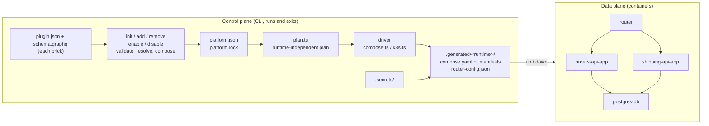
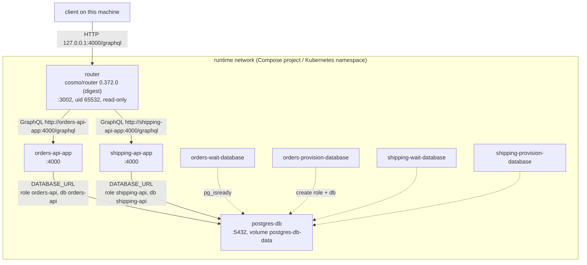
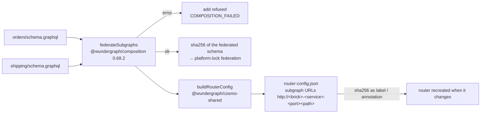
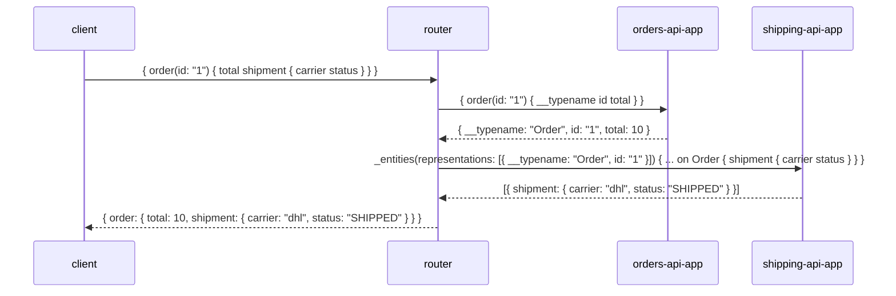
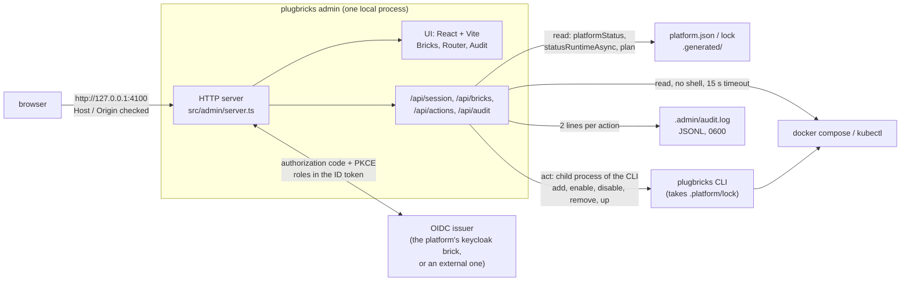

# Architecture

How plugbricks works, from the files a user writes to the containers that answer a GraphQL request.
This document grows with the project: each section says whether it describes what is **built** or
what is **planned**. The reasons behind each choice are in `docs/decisions.md` (D1, D2, …); this
document links to them instead of repeating them.

## 1. Vocabulary

| Word | Meaning |
|---|---|
| **Brick** | A directory with a `plugin.json` (the manifest): one or more services, what it provides, what it requires, optionally a GraphQL subgraph. Example: `postgres`, `orders-api`, `shipping-api`. |
| **Service** | One container of a brick. Its runtime name is `<brick>-<service>` (`postgres-db`, `orders-api-app`), which is also its DNS name on the runtime network. |
| **Capability** | A named thing a brick provides and others require, for example `database`. One provider per capability on a platform. |
| **Subgraph** | The GraphQL schema a brick serves (`subgraph` in the manifest), written in Federation v2. |
| **Router** | The Cosmo router, the single GraphQL entry point. Not a brick: plugbricks adds it when at least one brick serves a subgraph (D9). |
| **Platform** | A project directory with `platform.json` (what the user asked for) and `platform.lock` (what was resolved). |
| **Driver** | Turns the platform into runtime files: Docker Compose or Kubernetes (D5). |

## 2. Two planes

plugbricks is split like most platforms:

- the **control plane** decides *what should run*. It is the `plugbricks` CLI: it reads manifests,
  checks them, writes `platform.json` / `platform.lock`, renders runtime files and calls
  `docker compose` or `kubectl`, then exits. The admin (section 8) is the only long-running part, and
  it changes nothing itself: it runs the same CLI.
- the **data plane** is *what runs*: the services of the bricks, their wait and provision tasks, and
  the router. It does not know plugbricks exists; it only sees the files the driver rendered.



With a `keycloak` brick and an `orders-web` page (D17, D18), the same data plane also holds the
platform's identity provider and the shop page: both are web bricks, published on their own loopback
port. The router then requires a token (D19) and passes it on to the subgraphs (D20).

## 3. Control plane: from a manifest to running containers (built)

0. **`create <name> --kind api|web`** (D28) writes a brick from the templates of the package: the brick in
   `bricks/<name>-<kind>`, the code of its service and its image recipe in `services/<name>-<kind>`, then adds the
   brick as step 1 does. The person builds the image.

1. **`add <name>` or `add <dir>`** finds the brick (a name is `bricks/<name>` of the project, or the folder of that
   name where the command was typed; both at once are refused, D25), validates the manifest against `schemas/plugin-manifest.schema.json`, checks the
   templates (D6), the image pinning rule, the runtime names, then resolves capabilities: a brick that
   requires `database` is refused while no installed brick provides it. A provider is never added
   without the person's agreement: `add` proposes the bricks of `bricks/` that meet what the brick requires or
   declares, asks in a terminal, adds them with `--yes`, and otherwise refuses and says what it would add (D26). If the platform would serve subgraphs, they are **composed before anything is
   written** (D8); a composition error refuses the add. The brick is copied, and its integrity hash
   goes into `platform.lock`.
2. **`remove <name>`** runs the same checks for the platform without the brick. It is refused while
   another brick requires what it provides, extends one of its entities (`EXTENDS_IN_USE`), or lists it in its
   `dependencies` (`DEPENDENCY_IN_USE`, D21; not when the entry is marked `optional`). Its
   volumes are kept by default (`retainedVolumes`, D3); its secrets are always kept (D6).
3. **`disable <name>` / `enable <name>`**: an installed brick is not necessarily enabled (D14).
   `disable` writes `enabled: false` in `platform.json`; the brick stays installed (its copy, lock
   entry, volumes, secrets and name are kept) but `generate` and `up` no longer render it, so the next
   `up` stops it. `enable` removes the flag. The same consistency rules as `add` / `remove` apply:
   disabling a provider an enabled brick requires is `CAPABILITY_IN_USE`, disabling an owner an enabled
   brick extends is `EXTENDS_IN_USE`, enabling a consumer of a disabled provider is
   `PROVIDER_DISABLED`; the federated schema is recomposed on every toggle. A dependency declared in
   `dependencies` (D21) that an **enabled** brick lists blocks a disable with `DEPENDENCY_IN_USE` (a disabled
   declarer does not block); `remove` keeps disabled declarers included.

   | | in `platform.json` | `enabled` | rendered and running after `up` | volumes and secrets |
   |---|---|---|---|---|
   | not installed | no | — | no | none, or kept from an earlier `remove` |
   | installed, disabled | yes | `false` | no | kept |
   | installed, enabled | yes | `true` or absent | yes | kept |
4. **`generate`** builds a plan from the lock and the installed copies (integrity checked again), then
   the driver renders it. Drivers are pure functions plan → files, tested with golden files.
5. **`up` / `down`** render, then call the runtime. `up --prune-volumes` deletes only the volumes the
   lock lists in `pendingDeletion`.
6. **One changing command at a time** (D16): `add`, `remove`, `enable`, `disable`, `generate`, `up`
   and `down` hold `.platform/lock` while they run; another one meanwhile, from a terminal or from the
   admin, is refused with `PLATFORM_BUSY`. Reading (`status`, `admin`) never takes it.
7. **`status`** compares what was asked, what was resolved and the federation hash
   (`FEDERATION_CHANGED`). `status --runtime compose|k8s` adds what the runtime really runs,
   read-only (D10): per brick, service and router, `enabled` vs `deployed`, state, reason, restart
   count and instances, as a table or as a versioned JSON report (`schemas/status-runtime.schema.json`).

## 4. Data plane: the example shop (built)

With `postgres`, `orders-api` and `shipping-api` installed on Docker Compose, `generate` renders these
services (golden file `test/fixtures/cli/generate-compose`, plus shipping):



Who talks to whom:

| From | To | Protocol | Credential | Why |
|---|---|---|---|---|
| client | router | HTTP, `127.0.0.1:<router.port>` only | a JWT when an `oidc` provider is enabled (D19), none otherwise | the published GraphQL entry point (D9) |
| client | `orders-web-app` | HTTP, `127.0.0.1:<webPort>` only | none | the shop page (D17) |
| router | `orders-api-app`, `shipping-api-app` | GraphQL over HTTP, internal names | the caller's `Authorization` header, propagated (D20) | federated query plan |
| `orders-web-app` | `keycloak-app` | OIDC token endpoint (HTTP) | its own client id and secret | gets a token for the router (D19) |
| `orders-api-app`, `shipping-api-app` | `keycloak-app` | JWKS over HTTP | none | verifies the token it receives (D20) |
| `orders-api-app` | `postgres-db` | PostgreSQL | its own role and password, `DATABASE_URL` | its data |
| `shipping-api-app` | `postgres-db` | PostgreSQL | its own role and password | its data; refused on the `orders-api` database |
| `<consumer>-wait-database` | `postgres-db` | `pg_isready` | none | waits until the database answers |
| `<consumer>-provision-database` | `postgres-db` | `psql` | superuser password | creates the consumer's role and database, idempotent |

**Web bricks (D17).** A brick may declare the service that serves its pages (`web: { service, path }`).
`add` gives it a `webPort` in `platform.json`; Compose publishes that service on `127.0.0.1:<webPort>`
only, Kubernetes keeps a ClusterIP reached with `kubectl port-forward` on the same local port. The router
accepts browser calls only from the origins of the enabled web bricks, and the service receives
`GRAPHQL_URL` (the router inside the platform) and `PUBLIC_GRAPHQL_URL` (the browser's view of it).
`examples/orders-web` is the shop page.

**Tokens (D19, D20).** When an enabled brick provides `oidc` (the `keycloak` brick, D18), the router
requires a JWT signed by that provider (issuer, audience `plugbricks-router`, RS256, keys from the
provider) and starts only after it. It forwards `Authorization` to the subgraphs, and each API checks
the token again with `jose`: a call that reaches an API directly, past the router, without a valid
token gets 401. Each consumer of `oidc` gets its own confidential client (`OIDC_TOKEN_URL`,
`OIDC_CLIENT_ID`, `OIDC_CLIENT_SECRET`); `orders-web` uses it. Without an `oidc` provider, nothing
changes: no token, no rule.

Rules that hold for every platform:

- **No brick talks to another brick's storage.** Each consumer gets its own role, database and
  password from the provider; shipping knows orders only through the graph.
- **Only the router and the web bricks' pages are published**, and only on the loopback address
  (Compose) or as a ClusterIP Service (Kubernetes). No Ingress, NodePort or LoadBalancer (D9, amended
  by D17).
- **Secrets never appear on a command line or in `.generated/`.** They live in `.secrets/`, mode 0600,
  and reach containers as environment variables (D6).

## 5. How a capability is wired: `provides` / `requires` (built)

The provider describes, once, how to make itself usable by any consumer. In `examples/postgres`:

- `ready`: a command run from outside that exits 0 when the database accepts connections;
- `provision`: a one-shot task (image + script) that creates the consumer's role and database;
- `inject`: the variables added to each consumer, here
  `DATABASE_URL=postgres://${consumer.name}:${secrets.consumer_password}@${provider.host}:${provider.port}/${consumer.name}`.

The consumer only says `"requires": { "database": { "wait": "healthy", "timeoutSeconds": 120 } }`.
The start order is the same on both runtimes (D5):


Compose chains the tasks with `service_completed_successfully`; Kubernetes runs them as init
containers `wait-database` and `provision-database` in each consumer pod.

Secret scope (D6): a secret the provider's own services use belongs to the provider
(`PB_POSTGRES__SUPERUSER_PASSWORD`); any other secret in `provision` or `inject` is generated per
consumer (`PB_POSTGRES__ORDERS_API__CONSUMER_PASSWORD`).

The same wiring carries `queue` (D11, D12). `examples/rabbitmq` provides one broker; `ready` is a TCP
check, and the provision task creates the consumer's vhost, user and permissions through the management
API (an `extraPorts` port of the Service). Each consumer gets `AMQP_URL` with its own credentials and
`QUEUE_NAME=<its brick name>`, then declares its own queue. `examples/nats` (D13) is a second provider
of the same capability, with core NATS only: `NATS_URL` and `SUBJECT=<its brick name>`, no accounts and
no JetStream.

It also carries `cache` and `object-storage` (D41). `examples/redis` creates one user per consumer, limited to
the keys and channels `<brick>:*` (`REDIS_URL`, `REDIS_PREFIX`). `examples/seaweedfs` creates one bucket and one
S3 key per consumer through its S3 port, the only one open in the platform (the names of the AWS tools, and
`S3_BUCKET`). Both servers are configured by `services[].args`, the arguments of their image's entrypoint.

**Optional requirements, and `oidc` (D19).** A requirement may say `"optional": true`: without a
provider the brick runs as it is; when a provider is added (or enabled) later, the plan wires it. This is
how `orders-web`, `orders-api` and `shipping-api` run with or without Keycloak. `examples/keycloak` provides
`oidc`: `ready` asks for the realm's discovery document; `provision` creates one confidential client per
consumer (its own secret, an audience mapper adding `plugbricks-router`); `inject` adds
`OIDC_TOKEN_URL`, `OIDC_CLIENT_ID`, `OIDC_CLIENT_SECRET`, `OIDC_ISSUER`, `OIDC_JWKS_URL` and
`OIDC_AUDIENCE`. The provider's manifest also carries `oidc: { issuerPath, jwksPath, audience }`, which
tells the router and the admin where the issuer and the keys are.

A capability is not the only way a brick can need another one. `orders-web` reads its orders through the router,
so it cannot work without `orders-api`, and no capability says so. A manifest can list such plugins in
`dependencies` (D21). The admin shows them with the capabilities and the extended entities; `remove` refuses a
brick that another declares (`DEPENDENCY_IN_USE`), `disable` refuses it while the declaring brick is enabled,
`add` warns when a declared brick is not installed, and `up` does not wait for it. An entry marked `optional`
(`orders-web` lists `shipping-api` that way: its page shows the shipment when shipping is there and works without it)
is only shown, and used for the roles below.

An API says who may call it with an `authorization` block (D22): `{ "queries": "orders:read", "mutations":
"orders:write" }`, the client roles a token needs to run a query and to run a mutation. The block needs a
`subgraph` and `requires.oidc`. With an `oidc` provider the plan puts the two roles in the API's env
(`AUTHORIZATION_QUERIES_ROLE`, `AUTHORIZATION_MUTATIONS_ROLE`), and the provision task of `examples/keycloak`
creates them as roles of the API's own client (`ROLES`). A brick that lists the API in `dependencies` says what it
does with it, `"operations": ["queries"]` by default or `["mutations"]` too, and its provision task gives its
service account the matching roles (`GRANTS`). The API checks `resource_access.<its client>.roles` after the token
check and before any resolver: a valid token without the role is refused with the GraphQL code `FORBIDDEN` and HTTP
403; a token that is not valid is still 401. Without an `oidc` provider, or for a class the block leaves out,
nothing changes.

## 6. GraphQL Federation v2 (built)

Each API brick serves a **subgraph**. Both examples declare Federation 2.5:

```graphql
extend schema @link(url: "https://specs.apollo.dev/federation/v2.5", import: ["@key"])
```

**Entity ownership.** `orders-api` owns the entity `Order` (`id`, `total`, `status`) with
`@key(fields: "id")`. `shipping-api` declares the same entity with the same key and adds one field,
`shipment`. Its manifest says so explicitly: `"extends": [{ "plugin": "orders", "entities": ["Order"] }]`.
That field is what lets plugbricks refuse `shipping-api` without `orders-api` (`EXTENDS_OWNER_MISSING`) and
refuse `remove orders-api` while shipping is installed (`EXTENDS_IN_USE`); composition alone cannot see
that intent (D8).

**At add time** (`src/federation.ts`, the only file importing the composer):



**At request time**, a query that spans both subgraphs:



The two sub-requests show the Federation v2 mechanism, not a capture: the exact text the router
sends was not recorded. What was checked end to end on Docker Compose (D8, D9) is the client's request
and answer, and that shipping answers `_entities` for an `Order` it never stored: it only needs the key.

**Known limits** (D8, kept on purpose and asserted by tests): `shipOrder` accepts an order id that does
not exist, because shipping cannot see the orders database; and a brick that redefines an entity
without listing it in `extends` is not detected.

## 7. Security model of the data plane (built)

| Concern | Rule | Where |
|---|---|---|
| Exposure | only the router and the web bricks' pages, loopback / ClusterIP | D9, D17 |
| Browser origins | the router accepts only the origins it lists (`CORS_ALLOW_ORIGINS`); any other gets 403 and nothing runs | D17 |
| Authentication | with an `oidc` provider, the router requires a JWT (issuer, audience, RS256, keys from the provider) and each API checks it again (the example APIs and the services `create` writes); without one, no token | D19, D20, D46 |
| Service identity | one confidential OIDC client per consumer, its own secret, injected by `oidc`; the router forwards the caller's token, and APIs never trust an identity header | D19, D20 |
| Authorization | with an `oidc` provider and an `authorization` block, each API requires the client role of the operation class (queries, mutations): `FORBIDDEN` / 403 without it; without a block, any valid token; no field-level rule | D20, D22 |
| Images | pinned to `MAJOR.MINOR` at least, or a digest; the router by digest | `src/image.ts`, `tools.json` |
| Router | non-root (65532), read-only filesystem, no capability, playground off, telemetry off | D9 |
| Data | one role and database per consumer; volumes kept unless pruned explicitly | D3, `examples/postgres` |
| Secrets | random, 0600, never on a command line, never in `.generated/`, never deleted | D6 |
| Kubernetes | never the current context; `--context` required | D5 |

The token flow, in one line: a caller gets a token from the platform's Keycloak (a user in the browser,
or a consumer's client credentials); the router validates it and forwards `Authorization`; each API
validates it again. No token, an invalid one, a wrong issuer or audience, or an expired one: 401 at the
router, and again at the API. The tokens live 300 s; a service of the platform holding a valid token can
still call any API: per-field or per-role authorization is not built (D20).

## 8. The admin (built)

`plugbricks admin` is a local web server for the platform (D15). It is part of the control plane, not
a brick: it does not run in the runtime, and it never changes the platform itself. It reads what the CLI
reads, and to change something it runs the CLI.



- **Pages:** *Bricks* (the table of the mockup: tags, port, subgraph, extends, `enabled` vs `deployed`,
  runtime state and reason, actions; a click on a brick opens a panel with its dependencies and its details,
  D21), *Router* (configuration hash and size, source file, composition,
  composed SDL, read-only) and *Audit*.
- **Reading** uses the same functions as the CLI: `platformStatus`, the plan, and `statusRuntimeAsync`,
  which gives the same report as `status --runtime` without blocking the server. Concurrent page loads
  share one read of the runtime.
- **Acting:** `POST /api/actions` with `add` (a path relative to the platform), `enable`, `disable`,
  `remove` (a brick name) or `up`. The admin role is required; names and paths are checked before
  anything runs; the action is a child process of the built CLI, without a shell, one at a time (`409
  BUSY`), and `PLATFORM_BUSY` from the platform lock is reported if a terminal command holds it. There is
  no `--prune-volumes`: deleting data stays a terminal decision.
- **Who may do what:** sign-in with OIDC (authorization code + PKCE, public or confidential client).
  `plugbricks-viewer` reads, `plugbricks-admin` reads and acts; no role, no access. With an `oidc`
  provider in the platform, the admin finds its issuer when `--issuer` is absent (D19); `--issuer` still
  wins, and an external issuer still works (`docs/keycloak.md`). `--dev` turns authentication off for
  local use. Sessions are in memory and end after 8 hours on the server.
- **Audit:** every action writes one line when accepted and one when it ends (`Success`, `Refused`,
  `Failed`), with the user, the role, the action id and the duration; never the output, never a secret.
- **Exposure:** like the router, loopback only. The server listens on `127.0.0.1` and refuses any
  request whose `Host` or `Origin` is not the loopback address (protection against DNS rebinding).

## 9. Not built yet

1. **Field-level authorization.** The role is per operation class (all queries, all mutations) of an API
   (D22, step A). A rule on one field (`@authenticated`, `@requiresScopes`, enforced by the router and by each API)
   is the later step B (studied in D42: the router already applies the directives); a role removed in Keycloak stays
   valid in the tokens already issued until they expire (300 s by default).
2. **Kafka**, as a third `queue` provider (deferred, see the README roadmap).
