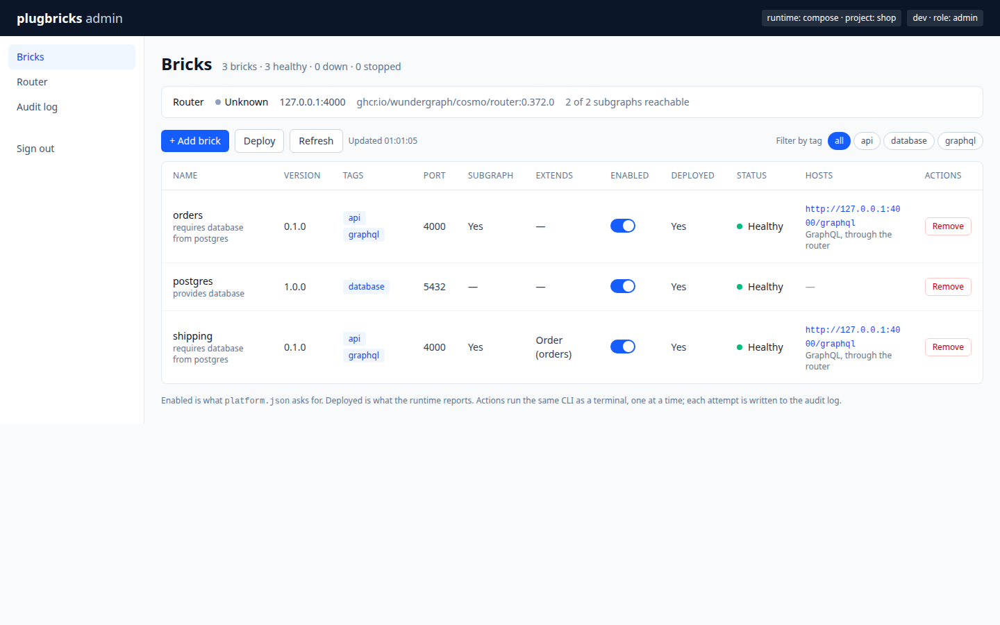
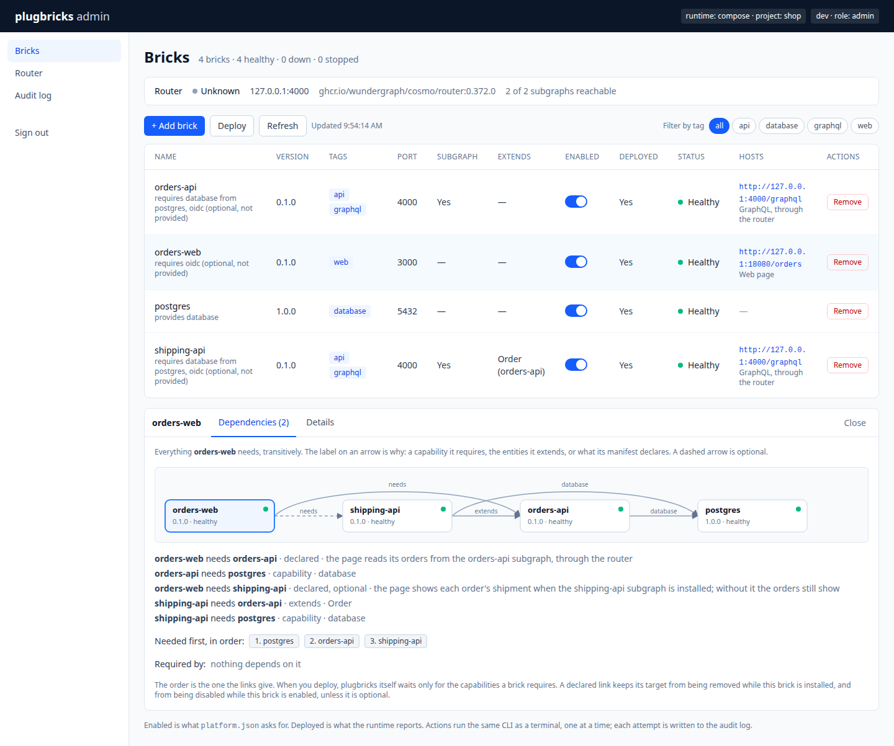
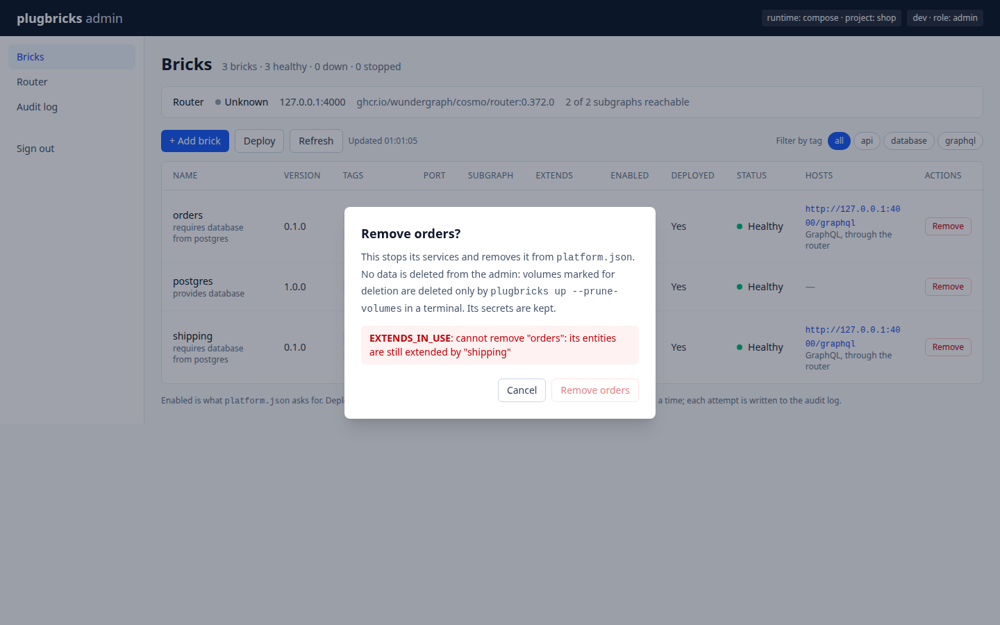
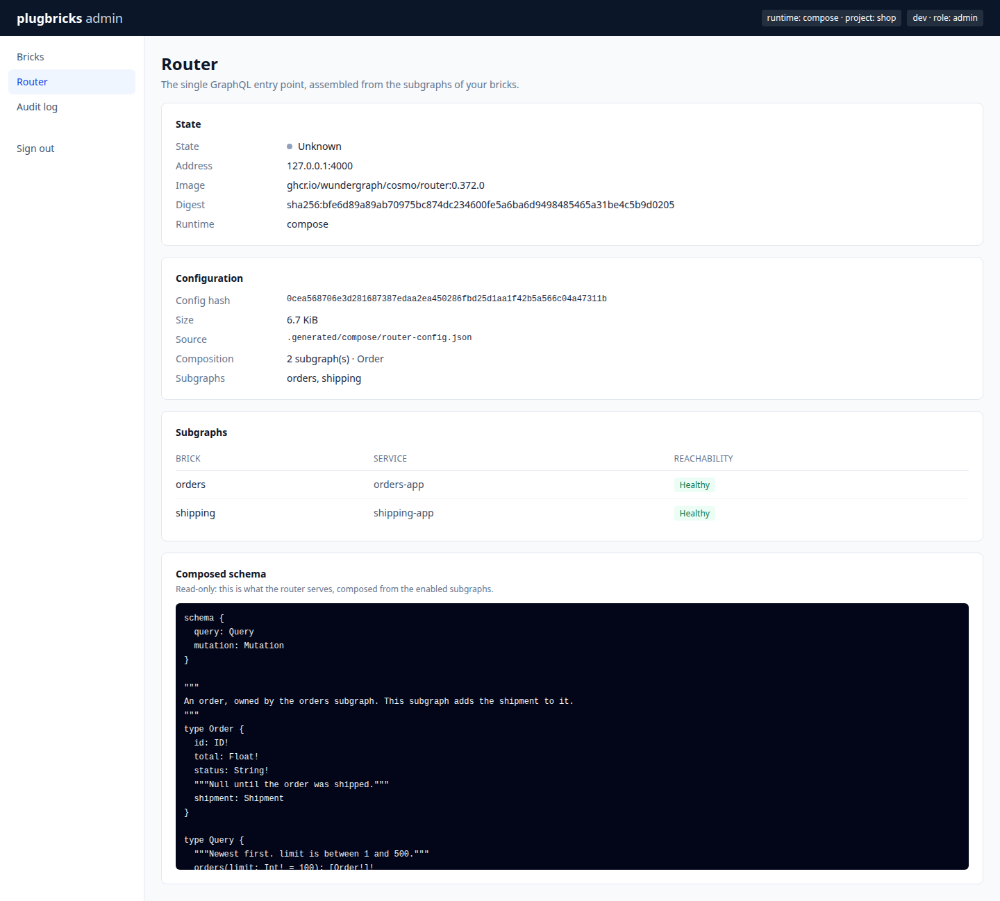
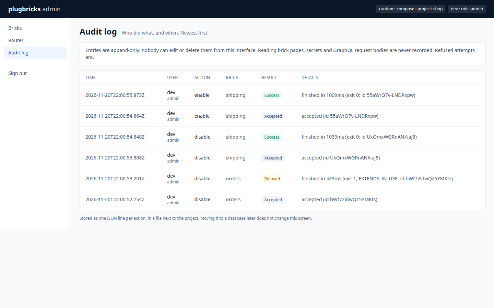

# The admin

`plugbricks admin` is a local web interface over a platform: its bricks, what each needs, the router and an audit log.
`plugbricks admin --dev` serves it on
`http://127.0.0.1:4100` (Bricks, Router, Audit). Without `--dev`, pass `--issuer` and `--client-id`
and set `PLUGBRICKS_OIDC_CLIENT_SECRET` only for a confidential client (a public client uses PKCE
alone); the account needs `plugbricks-viewer` (read) or `plugbricks-admin` (read and act). A real
Keycloak walkthrough is in [Keycloak with the admin](../keycloak.md). From the Bricks page an administrator can add a brick (a path
relative to the platform), enable or disable it, remove it, or deploy (`up`); each action runs the
CLI as a child process, one at a time, and is written twice to `.admin/audit.log` (accepted, then its
outcome). There is no `--prune-volumes` in the admin: deleting data stays a terminal decision. A
viewer sees the same pages and cannot change anything. The Router page shows the configuration hash,
size, source, composition and composed schema.

## Its pages

The screenshots below were taken on a real platform (`postgres`, `orders-api`, `shipping-api`, `orders-web` and
the router on Docker Compose, admin in `--dev`). On Compose the router has no healthcheck (its image has no shell), so its state is shown as `Unknown` while it runs.

**Bricks**: what `platform.json` asks for next to what the runtime reports; a subgraph brick is reached
through the router, a web brick's page on its own loopback port.



**What a brick needs** (the screenshot is from an earlier version, without the optional links): a click on a brick opens a panel under the table. *Dependencies* draws everything the brick
needs, transitively: the capabilities it requires, the entities it extends, and the plugins its manifest lists in
`dependencies`. Here `orders-web` needs `orders-api`, which needs `postgres`; the arrow says why. Below it, the
bricks needed first, in order, and who requires this one. A brick that is needed but not installed is flagged. *Details*
gathers status, restarts, port, `provides`, `requires`, `extends` and what would refuse its removal. A declared
dependency protects its target from `remove` (`DEPENDENCY_IN_USE`), here `orders-api` while `orders-web` is installed,
and from `disable` while the declaring brick is enabled; `add` warns when the declared brick is not installed, and `enable` when it is disabled;
`up` waits only for the capabilities a brick requires. A dependency marked `optional` (here `shipping-api`, which
`orders-web` can run without) is shown as optional and protects nothing.



**Removing a brick**: the dialog shows the CLI's refusal before anything runs, here `orders-api`, whose
`Order` entity `shipping-api` extends.



**Router**: the configuration, the subgraphs it calls and the composed schema, read-only.



**Audit log**: two lines per action, accepted then its outcome, refusals included.



## Signing in with the Keycloak brick

With the [`keycloak` brick](./capabilities.md#tokens) installed:

Sign into the console as `admin` with the password `PB_KEYCLOAK__ADMIN_PASSWORD` from
`.secrets/secrets.env`, create the users and give them `plugbricks-admin` or `plugbricks-viewer`, then:

```bash
npx plugbricks admin --client-id plugbricks-admin   # the issuer is the keycloak brick's, found in the platform
```

`--issuer` still overrides it (an external issuer, [Keycloak with the admin](../keycloak.md)).

The brick uses `${web.origin}`, the address the browser uses (`http://127.0.0.1:<webPort>`), a template
allowed only in the env of a web brick's own service. The realm is imported on the first start only, and
the admin must run on port 4100, the redirect URI of the realm's client.
