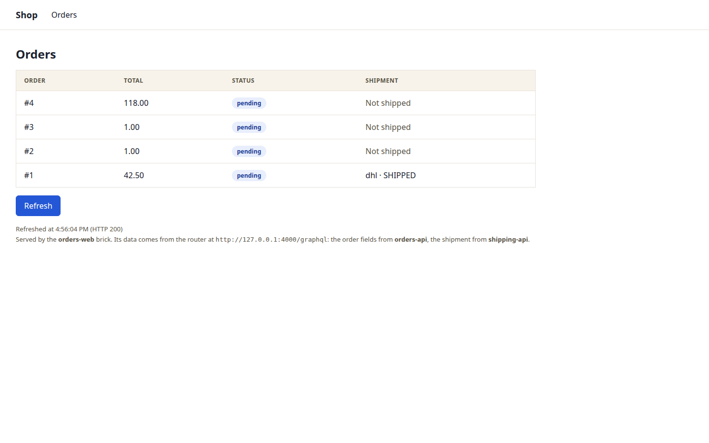
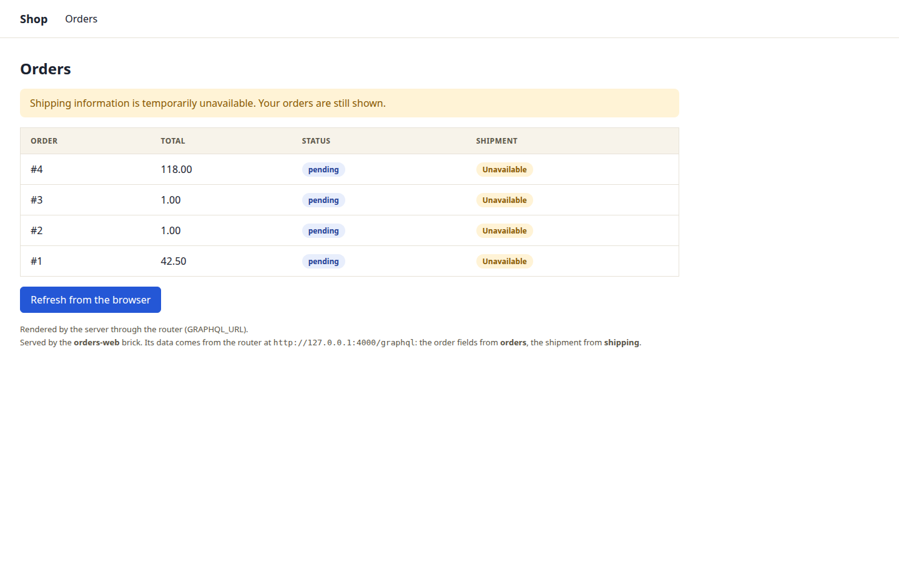

# Writing a brick

A brick is a folder with a `plugin.json`, its manifest, and the files the manifest names. Put it in your project's
`bricks/` folder and add it by name.

The manifest is checked against
[`plugin-manifest.schema.json`](../../packages/plugbricks/schemas/plugin-manifest.schema.json): an editor that reads
`$schema` completes it, and `add` refuses what is wrong with a stable error code and the faulty field.

## An example

An API that stores data in PostgreSQL:

```json
{
  "$schema": "https://raw.githubusercontent.com/rudney5000/plugbricks/main/packages/plugbricks/schemas/plugin-manifest.schema.json",
  "name": "catalog-api",
  "version": "0.1.0",
  "description": "The products of the shop.",
  "tags": ["api", "graphql"],
  "services": [
    {
      "name": "app",
      "image": "ghcr.io/example/catalog-api:1.0.0",
      "port": 4000,
      "healthcheck": { "exec": ["wget", "-qO-", "http://127.0.0.1:4000/health"] },
      "env": { "SIGNING_KEY": "${secrets.signing_key}" }
    }
  ],
  "requires": { "database": { "wait": "healthy", "timeoutSeconds": 120 } },
  "subgraph": { "service": "app", "schema": "schema.graphql", "path": "/graphql" }
}
```

## The fields

`name`, `version` and `services` are required.

| Field           | What it says                                                                                                 |
| --------------- | ------------------------------------------------------------------------------------------------------------ |
| `$schema`       | The address of the manifest's JSON Schema, for your editor.                                                  |
| `name`          | The brick's identity: lower case letters, digits and dashes. Its services are `<name>-<service>` at run time. |
| `version`       | The brick's version (semver).                                                                                |
| `description`   | What the brick is for.                                                                                       |
| `tags`          | Free labels (`api`, `graphql`, `database`, …), shown by the admin and the JSON reports.                      |
| `services`      | The containers of the brick (see below). Empty only for a [subgraph that runs elsewhere](./existing-services.md). |
| `subgraph`      | The GraphQL API the brick adds to the router: `service` and `schema`, with `path`, `grpc`, or a `url`.       |
| `extends`       | Entities of another brick that this subgraph adds fields to: `[{ "plugin": "orders-api", "entities": ["Order"] }]`. |
| `requires`      | The capabilities the brick needs ([database, queue, tokens](./capabilities.md)).                             |
| `provides`      | The capabilities the brick offers to the others (see below).                                                 |
| `dependencies`  | Other bricks it needs besides its capabilities, for example an API it calls.                                 |
| `authorization` | The role a token needs to query or to mutate this API ([tokens](./capabilities.md#tokens)).                  |
| `web`           | The service that serves web pages (see below).                                                               |
| `oidc`          | For an identity provider only: what the router needs to check its tokens.                                    |

## Services

Each service needs a `name`, an `image` and a `port`.

- **`image`** is pinned: a digest, or a tag that starts with at least `MAJOR.MINOR` (`16.4-alpine`, `v1.2.3`). `latest`,
  `16` and `alpine` are refused.
- **`healthcheck.exec`** is a command run inside the container; the platform waits for it. Without one the service is
  reported as running, with unknown health.
- **`env`** holds fixed variables. The only templates are `${secrets.<name>}`, a secret plugbricks generates for this
  brick, and, on a web brick's own web service, `${web.origin}`. Never write a secret in clear.
- **`volumes`** are kept by default when the brick is removed (`retention: "retain"`); `"delete"` marks them for
  `up --prune-volumes`.
- **`extraPorts`** names additional ports, reachable inside the platform only.

## Requirements

```jsonc
"requires": {
  "database": { "wait": "healthy", "timeoutSeconds": 120 },
  "oidc": { "optional": true }
}
```

`wait` says when the brick may start: once the provider answers (`healthy`, the default) or as soon as it runs
(`started`). After `timeoutSeconds` (120 by default) `up` fails with `WAIT_TIMEOUT`. An `optional` capability is wired
when a provider is installed, even later, and ignored otherwise.

## Providing a capability

A provider says which service offers the capability, how to know it is ready, a task that prepares each consumer, and
the variables the consumer receives:

```jsonc
"provides": {
  "database": {
    "service": "db",
    "ready": { "exec": ["pg_isready", "-h", "${provider.host}"] },
    "provision": { "image": "postgres:16.4-alpine", "command": ["/bin/sh", "/provision/create-database.sh"], "scripts": "provision" },
    "inject": { "DATABASE_URL": "postgres://${consumer.name}:${secrets.consumer_password}@${provider.host}:${provider.port}/${consumer.name}" }
  }
}
```

The provision task runs once per consumer, before it starts, and must be safe to run again. A platform has one provider
per capability. [`examples/postgres`](../../packages/plugbricks/examples/postgres/plugin.json) is the complete example.

## Dependencies

```jsonc
"dependencies": [
  { "plugin": "orders-api", "description": "the page reads its orders from it", "operations": ["queries"] }
]
```

`add` proposes a missing dependency from `bricks/`. `remove` refuses to take away a brick that an installed one declares,
and `disable` while the declaring brick is enabled. `"optional": true` shows the link and protects nothing. With an
identity provider, `operations` gives the brick the roles it needs to call that API.

## Web pages

`"web": { "service": "app", "path": "/orders" }` publishes that service on `127.0.0.1:<webPort>` (the port `add` chose
in `platform.json`, from 8080); on Kubernetes it stays inside the cluster. With a router, the service receives
`GRAPHQL_URL` (the router inside the platform) and `PUBLIC_GRAPHQL_URL` (for code that runs in the browser), and the
router accepts browser calls from those pages only.

The example `orders-web` (source [`apis/orders-web`](../../apis/orders-web)) is the shop's orders page: its server reads the orders
and their shipment through the router, and when shipping does not answer it still lists the orders with
the shipment marked unavailable.



With the shipping container stopped, the same page:


